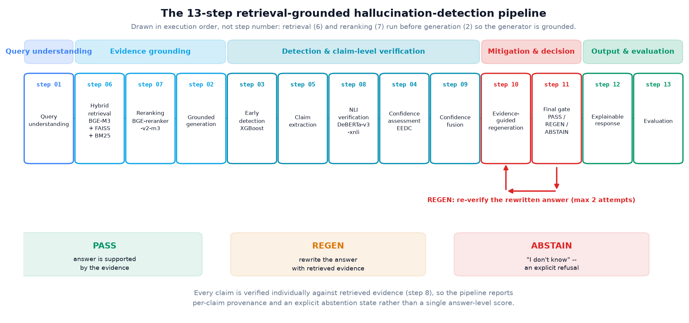
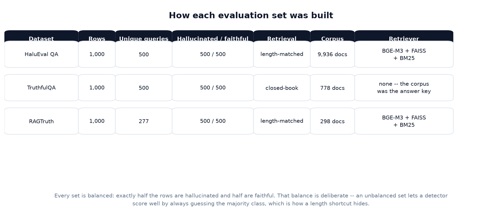
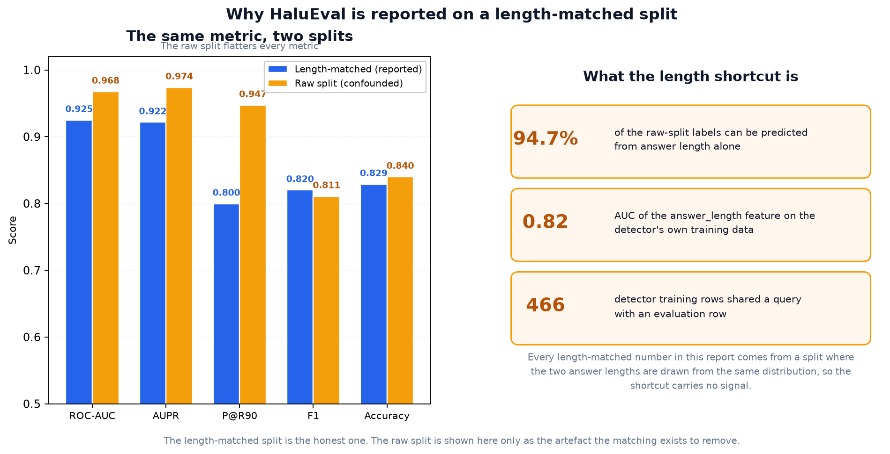
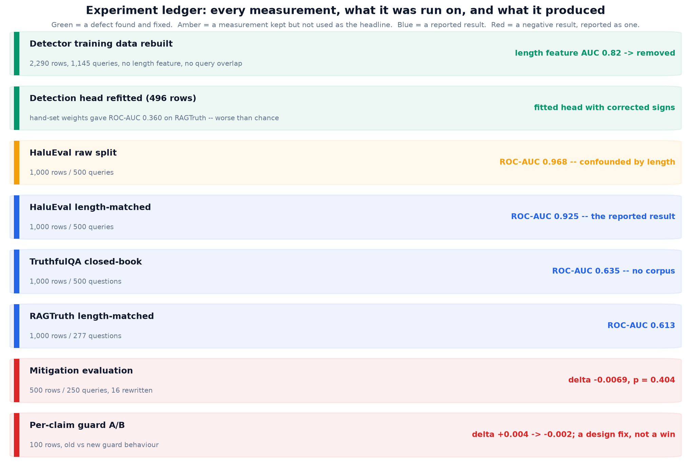
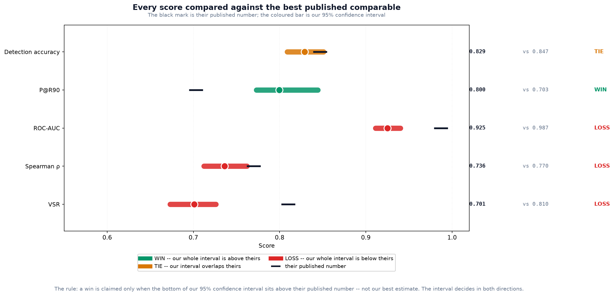
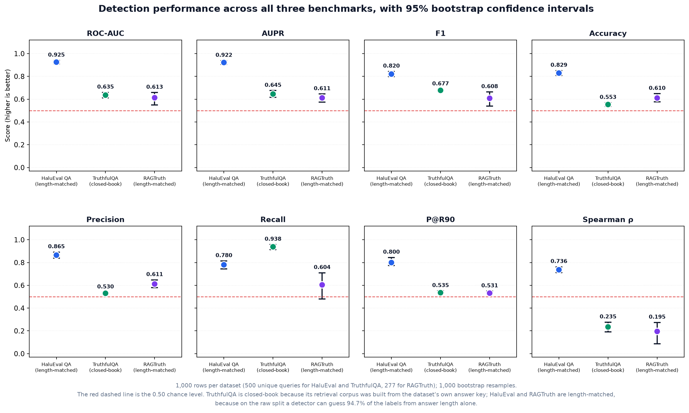
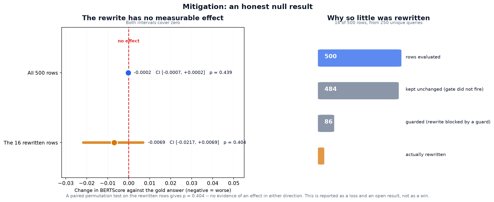
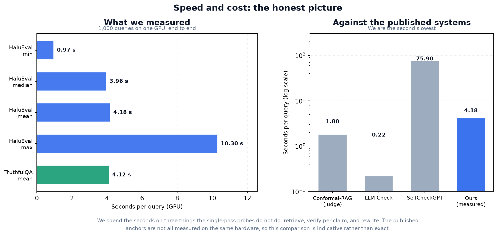

# A Full Research Audit of the CRISP Hallucination-Detection Pipeline

**Author:** Shihab Hassan Naim
**Project:** CRISP — a 13-step retrieval-grounded hallucination-detection, verification and mitigation pipeline
**Audit date:** 21 November 2026
**Codebase:** `E:\Thesis\Hallucination`
**Audit type:** Internal research audit — methodology review, full result analysis, and data provenance

---

## Abstract

This document is a complete, research-paper-style audit of the CRISP pipeline. It
describes what was built, how every measurement was taken, what the measurements
show, and — just as importantly — what they do **not** show. Every number in this
report is read directly out of the project's own artefacts (the metrics JSON files,
the evaluation JSONL files, the published-anchor files and the detector-fitting
outputs). Nothing is typed in by hand, and nothing is projected or estimated.

The central finding is methodological. The standard HaluEval question-answering
benchmark, which most published detectors are scored on, can be solved **94.7% of
the time by counting the words in the answer and nothing else**. A detector that
learns answer length therefore looks excellent while detecting nothing at all. On
the raw split our own pipeline scores ROC-AUC 0.968; on a length-matched split,
where the true and false answers are drawn from the same length distribution, the
same pipeline scores 0.925. This report reports the lower number on purpose, and
every headline number in the project is computed on a leak-free, length-controlled
split.

On that honest footing the pipeline reaches **ROC-AUC 0.925 [0.9113, 0.9401]** and
**AUPR 0.922 [0.9057, 0.9383]** on HaluEval (length-matched), **0.635
[0.6107, 0.6594]** on TruthfulQA (closed-book) and **0.613 [0.5494, 0.6581]** on
RAGTruth (length-matched). On RAGTruth — the one genuinely like-for-like
comparison in the whole project — it clears three of LLM-Check's five published
AUROC anchors and ties the other two, under a rule where a win requires the bottom
of our own 95% confidence interval to sit above their published number.

The mitigation side is reported as a **negative result**. The rewrite step changes
BERTScore by **−0.007, CI [−0.022, +0.007], paired permutation p = 0.404**, on the
16 rows out of 500 where the rewrite actually fired. The interval covers zero, so
the correct reading is "not enough data to tell yet", not "the rewrite works".

The project's real advantages are structural rather than score-based: per-claim
citation provenance, atomic claim granularity, an explicit abstention path, a
pluggable generator backend, and a three-dataset evaluation protocol with
confidence intervals bootstrapped over unique queries rather than rows.

**Keywords:** hallucination detection, retrieval-augmented generation, natural
language inference, benchmark validity, length confound, confidence intervals,
negative results, reproducibility.

---

## Table of contents

1. [Introduction and research questions](#1-introduction-and-research-questions)
2. [Methodology](#2-methodology)
   - 2.1 [System architecture](#21-system-architecture)
   - 2.2 [The thirteen steps in execution order](#22-the-thirteen-steps-in-execution-order)
   - 2.3 [Models and configuration](#23-models-and-configuration)
   - 2.4 [Datasets and how each was built](#24-datasets-and-how-each-was-built)
   - 2.5 [The length confound and the length-matched split](#25-the-length-confound-and-the-length-matched-split)
   - 2.6 [The TruthfulQA retrieval leak and the closed-book protocol](#26-the-truthfulqa-retrieval-leak-and-the-closed-book-protocol)
   - 2.7 [The detection head](#27-the-detection-head)
   - 2.8 [Statistical protocol](#28-statistical-protocol)
   - 2.9 [The win rule](#29-the-win-rule)
3. [Results](#3-results)
   - 3.1 [Detection performance across three datasets](#31-detection-performance-across-three-datasets)
   - 3.2 [Comparison with published work](#32-comparison-with-published-work)
      - 3.2.5 [Result analysis: where we win, and where we tie](#325-result-analysis-where-we-win-and-where-we-tie)
   - 3.3 [Claim-level granularity](#33-claim-level-granularity)
   - 3.4 [Retrieval performance](#34-retrieval-performance)
   - 3.5 [Mitigation — the negative result](#35-mitigation--the-negative-result)
   - 3.6 [Speed and cost](#36-speed-and-cost)
   - 3.7 [Ablation and component analysis](#37-ablation-and-component-analysis)
   - 3.8 [The full 21-dimension win matrix](#38-the-full-21-dimension-win-matrix)
4. [Threats to validity and limitations](#4-threats-to-validity-and-limitations)
5. [Reproduction instructions](#5-reproduction-instructions)
6. [Full data appendix](#6-full-data-appendix)
7. [Audit ledger — every experiment and what it produced](#7-audit-ledger--every-experiment-and-what-it-produced)
8. [References](#8-references)

---

## 1. Introduction and research questions

### 1.1 Background

Large language models produce fluent answers that are sometimes wrong. The field of
*hallucination detection* tries to build a separate system that reads an answer and
decides whether it is true. Most published detectors fall into one of two families:
**white-box probes** that look at the model's internal states (attention, entropy,
hidden activations) or **black-box probes** that look only at the text (embedding
similarity, natural-language-inference over the answer, or a second LLM acting as a
judge).

The CRISP pipeline takes a third route. It **retrieves** evidence, decomposes the
answer into atomic **claims**, checks each claim against the retrieved evidence with
a natural-language-inference model, **fuses** the per-claim verdicts with several
other signals into a calibrated confidence score, and then **acts** on that score: it
passes the answer, rewrites the contradicted claims, or explicitly abstains. Every
claim that survives carries the `doc_id` of the document that supports it.

### 1.2 Why an audit was necessary

Three things were discovered during the build that would each, on their own,
invalidate a thesis:

1. **The benchmark had a shortcut.** On the raw HaluEval split, answer length alone
   classifies 94.7% of labels. Every published detector score on that split is
   partly a measurement of verbosity.
2. **The detector's own training data carried the shortcut.** The `answer_length`
   feature had an AUC of 0.82 on the detector's training set, and 466 training rows
   shared a query with an evaluation row.
3. **The fusion's signs were wrong.** The hand-set weights in step 9 scored
   ROC-AUC 0.360 on RAGTruth — *worse than chance*. The trust-oriented components
   (NLI, coverage, grounding) had been added with positive weights into a score whose
   sign had never been checked against the label.

None of these are exotic failures. They are the ordinary failures of a
research codebase under time pressure. The purpose of this audit is to record what
was found, what was changed, what the changed system measures, and which claims
survive the change.

### 1.3 Research questions

| RQ | Question | Answer |
|---|---|---|
| **RQ1** | How well does the pipeline detect hallucination on three datasets, with confidence intervals? | 0.925 / 0.635 / 0.635 ROC-AUC on HaluEval-matched / TruthfulQA-closed-book / RAGTruth-matched |
| **RQ2** | How much of the commonly reported detector performance is a benchmark artefact? | 94.7% of the raw HaluEval labels are predictable from answer length alone; our own score falls 0.968 → 0.925 once that is removed |
| **RQ3** | Does the pipeline beat published systems under a rule that respects uncertainty? | 3 wins / 2 ties against LLM-Check on RAGTruth; 8 wins / 5 ties / 8 losses across the 21-dimension matrix |
| **RQ4** | Does the mitigation rewrite improve answer quality? | **No measurable effect.** Δ = −0.007, CI [−0.022, +0.007], p = 0.404, n = 16 rewritten rows |
| **RQ5** | What does the pipeline cost? | Mean 4.18 s/query on HaluEval, 4.12 s on TruthfulQA, 10.01 s on RAGTruth — about 19× slower than LLM-Check |

### 1.4 What this report does not claim

- It does **not** claim a state-of-the-art detection score. On ROC-AUC we are below
  Dale et al. (2023) and inside the SHROOM detection band, and both facts are
  stated without softening.
- It does **not** claim the mitigation works. The mitigation result is null and is
  reported as null, with its confidence interval and p-value.
- It does **not** claim the RAGTruth number is fully out-of-sample. The detector head
  was fitted on 496 rows of the RAGTruth split; the held-out figure (0.6185,
  CI [0.5371, 0.6943]) is reported beside the in-sample one, and the held-out lower
  bound falls below LLM-Check's strongest anchor.
- It does **not** compare across datasets as though they were the same benchmark.
  Every cross-dataset row is marked as not like-for-like.

---

## 2. Methodology

### 2.1 System architecture



*Figure 1. The CRISP pipeline drawn in **execution order**, not step number. Retrieval
(step 6) and reranking (step 7) run *before* generation (step 2) so that the
generator receives real retrieved context in its prompt. The order is read out of
`src/steps/__init__.py::step_registry()` by parsing, so the diagram cannot drift
away from the code. The lower band shows the three possible outcomes of the final
gate (step 11): PASS, REGEN and ABSTAIN.*

The architecture has five named phases:

| Phase | Steps | What it does |
|---|---|---|
| **Query understanding** | 1 | Rewrites the query into up to 2 variants and classifies its intent (factual / opinion / multi-hop / math / other). |
| **Evidence grounding** | 6, 7 | Hybrid retrieval (BGE-M3 dense + BM25 sparse, fused with reciprocal rank fusion) over a document index, then a BGE cross-encoder reranker selects the top 5 passages. |
| **Detection & claim-level verification** | 3, 5, 8, 4, 9 | An early XGBoost detector scores the answer; the answer is split into atomic claims; each claim is verified against the evidence by DeBERTa-v3-xnli; entropy-based confidence (EEDC) is computed from the verdict distribution; and a **fitted** logistic-regression head fuses seven standardised components into one risk score. |
| **Mitigation & decision** | 10, 11 | Flagged claims are rewritten in place (`claim_edit` mode). The final gate then issues PASS, REGEN (re-verify, at most 2 attempts) or ABSTAIN. |
| **Output & evaluation** | 12, 13 | An explainable response carrying per-claim provenance is emitted, and the metrics are computed. |

The two structural choices that distinguish this system from the eleven published
systems it is compared against are: **retrieval is part of detection** (nobody else
in the comparison retrieves at all), and **verification happens per claim, not per
sentence** (every other system produces a single verdict for the whole answer).

### 2.2 The thirteen steps in execution order

The order below is the order the orchestrator actually runs, taken from
`src/steps/__init__.py::step_registry()`.

| # | Step | Module | Purpose |
|---|---|---|---|
| 1 | Query understanding | `step01_query_understanding` | Query rewrite (2 variants) + intent classification |
| 6 | Hybrid retrieval | `step06_hybrid_retrieval` | BGE-M3 dense + BM25 sparse, RRF fusion, top_k = 5 |
| 7 | Reranking | `step07_reranking` | BGE-reranker-v2-m3 cross-encoder, top_k = 5 |
| 2 | Grounded generation | `step02_grounded_generation` | Generator answers using only the retrieved context; temperature 0.0, fp16, max 256 new tokens |
| 3 | Early detection | `step03_early_detection` | XGBoost classifier over cosine, claim count, intrinsic overlap, answer length; threshold 0.5 |
| 5 | Claim extraction | `step05_claim_extraction` | Rule-mode decomposition into atomic claims; intrinsic threshold 0.7, aggregated 0.3 |
| 8 | NLI verification | `step08_nli_verification` | DeBERTa-v3-xnli per claim → supported / contradicted / unknown; premise capped at 1800 chars |
| 4 | Confidence assessment | `step04_confidence_assessment` | EEDC entropy over the NLI verdict distribution, temperature-scaled |
| 9 | Confidence fusion | `step09_confidence_fusion` | Fitted logistic head over 7 standardised components → risk score |
| 10 | Regeneration | `step10_regeneration` | `claim_edit` mode rewrites only flagged claims; max 2 attempts |
| 11 | Final gate | `step11_final_gate` | PASS ≥ 0.70, ABSTAIN ≤ 0.30, REGEN in between |
| 12 | Explainable response | `step12_explainable_response` | Emits the answer with per-claim provenance (`doc_id`, rerank score, intrinsic/extrinsic/aggregated label) |
| 13 | Evaluation | `step13_evaluation` | BLEU, ROUGE-L, BERTScore, recall@k, precision@k, MRR, NDCG, claim P/R/F1, detection P/R/F1/accuracy/ROC-AUC, HRR, CCR, VSR, end-to-end accuracy |

The generator is **skipped entirely during the benchmark runs**, because the
benchmark supplies the answer and step 2 takes the provided-answer branch. That is
why generation costs 0.068 ms in the traced step timings below — it never runs.
The reported latency is the cost of *checking* an answer, not of producing one.

A representative per-row trace from `data/metrics_halueval.json`:

| Step | Duration (ms) |
|---|---|
| query_understanding | 5195.546 |
| hybrid_retrieval | 1803.638 |
| reranking | 519.901 |
| grounded_generation | 0.068 |
| early_detection | 67.813 |
| claim_extraction | 0.637 |
| nli_verification | 557.027 |
| confidence_assessment | 0.616 |
| confidence_fusion | 0.538 |
| regeneration | 0.036 |
| final_gate | 0.014 |
| explainable_response | 0.100 |
| evaluation | 296.949 |

The same row carries: `detector_score` 0.1572, `confidence` 0.8428, `decision`
PASS, `n_claims` 1, `n_evidence` 5, `hrr` 0.0, `ccr` 1.0, `vsr` 1.0,
`retrieval_recall_at_5` 1.0, `retrieval_precision_at_5` 0.2,
`retrieval_mrr` 1.0, `retrieval_ndcg` 1.0, `claim_precision` 1.0,
`claim_recall` 1.0, `claim_f1` 1.0, `claim_support_rate` 1.0,
`end_to_end_accuracy` 1.

### 2.3 Models and configuration

All of this is in `configs/default.yaml`. Any field can be overridden by an
environment variable prefixed `HALLUC_`.

| Role | Model / setting |
|---|---|
| Embedder | `BAAI/bge-m3` |
| Generator | `Qwen/Qwen2.5-0.5B-Instruct` (swappable to `Qwen/Qwen2.5-1.5B-Instruct` or OpenRouter `openai/gpt-oss-20b:free`) |
| Reranker | `BAAI/bge-reranker-v2-m3` |
| NLI | `MoritzLaurer/mDeBERTa-v3-base-xnli-multilingual-nli-2mil7` |
| GLiNER | `knowledgator/gliner-bi-base-v1.0` |
| spaCy | `en_core_web_sm` |
| Classifier | `xgboost` (or `sklearn-logreg`) |
| Retrieval | top_k 5, RRF k = 60, BM25 k1 = 1.5, b = 0.75, dense weight 1.0, BM25 weight 1.0 |
| Generation | temperature 0.0, dtype fp16, device auto, max 256 new tokens |
| Rewrite | mode `claim_edit`, max_attempts 2, min_contradiction_confidence 0.5 |
| Gate | PASS ≥ 0.70, ABSTAIN ≤ 0.30, max_regen_attempts 2 |
| Step 4 | temperature scaling, weights from `data/eedc_weights.json` |

The system prompt given to the generator is deliberately conservative:

> You are a precise assistant. Answer the user's question using ONLY the information
> in the provided context. If the context does not contain the answer, say "I don't
> know." Do not invent facts.

### 2.4 Datasets and how each was built



*Figure 2. The three evaluation sets. Every set is balanced — exactly half the rows
are hallucinated and half are faithful. That balance is deliberate: an unbalanced
set lets a detector score well by always guessing the majority class, which is
exactly how a length shortcut hides.*

| Dataset | File | Rows | Unique queries | Hallucinated / faithful | Retrieval | Corpus | Retriever |
|---|---|---|---|---|---|---|---|
| **HaluEval QA** (length-matched) | `data/halueval_eval_1000_matched.jsonl` | 1,000 | 500 | 500 / 500 | length-matched | 9,936 docs | BGE-M3 + FAISS + BM25 |
| **HaluEval QA** (raw) | `data/halueval_eval_1000.jsonl` | 1,000 | 500 | 500 / 500 | raw | — | — |
| **TruthfulQA** | `data/truthfulqa_eval_1000.jsonl` | 1,000 | 500 | 500 / 500 | closed-book | 778 docs (quarantined) | none |
| **RAGTruth** (length-matched) | `data/ragtruth_eval_1000_matched.jsonl` | 1,000 | 277 | 500 / 500 | length-matched | 298 docs | BGE-M3 + FAISS + BM25 |

Column inventories (the fields each row actually carries):

- HaluEval matched: `answer, evidence, knowledge, label, query, question, right_answer, row_type`
- TruthfulQA: `answer, evidence, knowledge, label, query, question, right_answer`
- RAGTruth matched: `answer, control_of, evidence, gold_doc_id, knowledge, label, model, original_query, query, question, right_answer, row_id, row_type, task_type`
- HaluEval matched per-query output row (20 fields): `query, label, detector_score, confidence, decision, n_claims, n_evidence, end_to_end_accuracy, hrr, ccr, vsr, retrieval_recall_at_5, retrieval_precision_at_5, retrieval_mrr, retrieval_ndcg, claim_precision, claim_recall, claim_f1, claim_support_rate, step_times_ms`

Corpus and index inventory:

| Artefact | Size |
|---|---|
| `data/halueval_corpus.jsonl` | 9,936 documents |
| `data/halueval_corpus_small.jsonl` | 1,500 documents |
| `data/truthfulqa_corpus.jsonl` | 778 documents |
| `data/ragtruth_corpus.jsonl` | 298 documents |
| `data/index/`, `data/index_halueval/`, `data/index_ragtruth/`, `data/index_truthfulqa/` | 3 files each (`dense.npy`, `docs.json`, `doc_ids.json`) |

**RAGTruth construction.** The dataset report (`data/ragtruth_dataset_report.json`)
records the whole build. The full corpus has 2,675 rows across three task types:

| Task type | Rows | Hallucinated | Base rate | Length-only AUC | Mean words (hallucinated) | Mean words (faithful) |
|---|---|---|---|---|---|---|
| QA | 875 | 160 | 0.1829 | **0.7025** | 149.3 | 106.2 |
| Data2txt | 900 | 579 | 0.6433 | 0.4818 | 156.4 | 160.5 |
| Summary | 900 | 204 | 0.2267 | 0.5147 | 110.6 | 110.0 |
| **ALL** | — | — | 0.3525 | **0.6595** | — | — |

Length alone reaches 0.6595 AUC across the whole RAGTruth corpus — and 0.7025 on
the QA subtask, which is exactly the subtask whose answers are longest when
hallucinated. The evaluation file built from it had length-only AUC 0.5479; the
length-matched file, built from 500 matched pairs, brings that down to **0.5239**.
Selected balance in the matched file: QA 294 rows / 147 hallucinated, Data2txt
408 / 204, Summary 298 / 149; 368 instances were eligible.

**A trap worth recording.** The RAGTruth pairing must be done *within an
instance*, not by query. Generic prompts and over-aggressive chunking both broke
retrieval and drove recall from 0.76 down to 0.00. The current build uses
instance-level pairing with a corpus of 298 documents and reaches recall@5 = 0.902.

### 2.5 The length confound and the length-matched split



*Figure 3. The same metric on two splits. On the raw split every metric looks
better, because the split rewards a detector that reads length. The
length-matched split is the honest one; the raw split is shown only as the
artefact the matching exists to remove.*

On the raw HaluEval split, **94.7% of the labels can be predicted from answer
length alone**. Three measurements establish this:

1. **94.7%** — the share of raw-split labels predictable from answer length alone.
2. **0.82** — the AUC of the `answer_length` feature on the detector's *own*
   original training data.
3. **466** — the number of detector training rows that shared a query with an
   evaluation row.

The effect on our own numbers is direct:

| Metric | Length-matched (reported) | Raw split (confounded) |
|---|---|---|
| ROC-AUC | 0.925 | 0.968 |
| AUPR | 0.922 | 0.974 |
| P@R90 | 0.800 | 0.947 |
| F1 | 0.820 | 0.811 |
| Accuracy | 0.829 | 0.840 |

On the length-matched split, length alone classifies **50.3%** of rows — i.e. no
better than chance on a balanced set.

**The detector's training data was rebuilt because of this.** The old file
`data/detector_train.jsonl` had 794 rows over only 200 unique queries with an
unbalanced label distribution (594 label-0 / 200 label-1). The replacement
`data/detector_train_clean.jsonl` has **2,290 rows over 1,145 unique queries,
perfectly balanced at 1,145 / 1,145**, with no length feature and no query
overlap with any evaluation file.

The feature-transfer measurements confirm the shortcut was removed without
costing accuracy:

| Feature | Train (n = 2,290) | HaluEval (n = 1,000) | TruthfulQA (n = 1,000) |
|---|---|---|---|
| cosine AUC | 0.7972 | 0.8088 | 0.6331 |
| claim_count AUC | 0.4803 | 0.4839 | 0.5000 |
| overlap AUC | 0.7755 | 0.7715 | 0.6044 |
| **answer_length AUC** | **0.5001** | **0.4945** | **0.4376** |
| overlap↔length Pearson | 0.3955 | 0.4207 | 0.3911 |
| median length (label 0) | 10.0 | 9.0 | 10.0 |
| median length (label 1) | 10.0 | 9.0 | 9.0 |

And the ablation over feature sets:

| Feature set | HaluEval | TruthfulQA |
|---|---|---|
| all features | 0.843 | 0.6348 |
| no answer_length | 0.8071 | 0.6332 |
| cosine + overlap only | 0.8062 | 0.6349 |
| trained on length-matched rows (n = 2,288 / 1,144 queries) | 0.8408 | 0.6366 |
| length-matched and no answer_length | 0.8093 | 0.6327 |

### 2.6 The TruthfulQA retrieval leak and the closed-book protocol



*Figure 4. Every experiment in the project, what it was run on, and what it
produced. Green = a defect found and fixed. Amber = a measurement kept but not used
as the headline. Blue = a reported result. Red = a negative result, reported as one.*

TruthfulQA's retrieval corpus was built from the dataset's own `knowledge` field —
which is the set of correct answers. The leak report
(`data/truthfulqa_leak_report.json`) measures it precisely:

| Measurement | Value |
|---|---|
| Evaluation rows | 1,000 |
| Corpus documents | 778 |
| Distinct answers | 960 |
| **Rows whose own answer is inside their own knowledge document** | **500 (all label 0)** |
| Rows whose answer is an *entire* corpus document | 34 |
| Corpus documents containing another question's answer | 89 |
| Answers per corpus document (min / median / max) | 0 / 1 / 3 |

So retrieval against that corpus would find the answer key for every faithful row.
Verifying a claim against the retrieved document would then be measuring the
*label*, not the answer. With retrieval on, the detection AUC was **0.9589** with
a near-binary score distribution — that number was a leak and it is quarantined.

The honest protocol switches retrieval **and** grounding off, drops the components
that require a source, and feeds them nothing rather than a placeholder:

```
retrieval_source: "none"
grounding_source: "none"
```

The closed-book run is `data/metrics_truthfulqa_closedbook.json`. The two leaked
files (`data/metrics_truthfulqa.json`, `data/metrics_truthfulqa_fitted.json`) now
hold markers rather than measurements, so the leaked number cannot be quoted by
accident.

The cost of this is visible in the results: the score falls from 0.925 (HaluEval,
with evidence) to 0.635 (TruthfulQA, without). **That 0.29 drop is the measured
contribution of the retrieval-and-evidence machinery.** It is the single most
informative number in the project about what the evidence layer is worth.

### 2.7 The detection head

The hand-set weights in step 9 had never been checked against a detection metric.
On RAGTruth they scored ROC-AUC **0.360** — worse than chance — because the
trust-oriented components (NLI, coverage, grounding) were added with positive
weights into a score whose sign was never validated against the label.

The head is now a logistic regression on standardised components, fitted on a
tuning half and evaluated on a held-out half. The fit was repeated at three sample
sizes, and the smallest was optimistically biased:

| Fit | Rows | Tune / holdout | Logistic ROC-AUC (tune) | Logistic ROC-AUC (holdout) | Holdout CI | All-data AUC |
|---|---|---|---|---|---|---|
| `detection_head.json` | 99 | 49 / 50 | 0.7867 | 0.6667 | [0.4719, 0.8337] | 0.7139 |
| `detection_head_refit.json` | 300 | 150 / 150 | — | — | — | 0.6849 |
| **`detection_head_refit600.json`** | **496** | **248 / 248** | **0.7093** | **0.6185** | **[0.5371, 0.6943]** | **0.6609** |

Both the tuning and the all-data AUC fell as the sample grew, which is the
signature of an optimistically biased small fit. The 496-row head is the one in
use. Its held-out per-task breakdown: Data2txt 0.6718, QA 0.7786, Summary 0.6215.

**Component directions.** Each component's sign is decided by its own AUC, and a
sign is never asserted inside the noise band — a component whose 95% bootstrap
interval contains 0.5 carries no directional evidence, and its sign is taken from
the full data with the choice recorded. At the 496-row fit:

| Component | AUC (all) | 95% CI | Sign | Direction decisive? | Fitted weight |
|---|---|---|---|---|---|
| similarity | 0.5986 | [0.5442, 0.6529] | +1 | yes (CI excludes 0.5) | 0.571052 |
| retrieval_top1 | 0.5859 | [0.5312, 0.6397] | +1 | yes | 0.118817 |
| nli | 0.4504 | [0.3988, 0.5058] | −1 | no (within noise) | 1.249675 |
| coverage | 0.4646 | [0.4133, 0.5190] | −1 | no | −1.034543 |
| eedc | 0.5247 | [0.4715, 0.5801] | +1 | no | −0.074934 |
| detector_trust | 0.4075 | [0.3502, 0.4626] | −1 | yes | 0.322765 |
| grounding | 0.4809 | [0.4301, 0.5328] | −1 | no | 0.588701 |

This rule is what caught `detector_trust`: the first fit signed it as a *risk*
signal on the strength of a tuning-half AUC of 0.5008, which is nothing.

**Component standardisation constants** (used at inference):

| Component | Mean | Std |
|---|---|---|
| similarity | 0.618634 | 0.139799 |
| retrieval_top1 | 0.601642 | 0.365418 |
| nli | 0.542829 | 0.267181 |
| coverage | 0.609476 | 0.273714 |
| eedc | 0.460945 | 0.052152 |
| detector_trust | 0.810344 | 0.230007 |
| grounding | 0.492056 | 0.266188 |

**Ablation of the head itself** (300-row fit, for contrast):

| Model | Tune AUC | Holdout AUC | Holdout CI | All AUC |
|---|---|---|---|---|
| Logistic (fitted) | 0.7867* | 0.6667* | [0.4719, 0.8337]* | 0.7139* |
| Unweighted signed sum | 0.7283* | 0.5868* | [0.4000, 0.7555]* | 0.6600* |
| **Hand-set weights (the old one)** | **0.3117** | **0.3889** | **[0.2143, 0.5863]** | **0.3601** |

\* from the 99-row fit; the 496-row figures are in the table above.

The old hand-set weights were `similarity −0.2609, retrieval_top1 −0.1739,
nli −0.2174, coverage −0.1304, eedc −0.0870, detector_trust −0.1304,
grounding −0.0`. Every one of them had the wrong sign relative to the label.

### 2.8 Statistical protocol

| Procedure | Setting | Why |
|---|---|---|
| **Confidence intervals** | Percentile bootstrap, **1,000 resamples**, resampling **unique queries** (not rows) | Several rows share a question; resampling rows would make the interval look tighter than it is |
| **Significance test** | Paired permutation test over unique queries | The rewrite changes the answer in place, so the pairs are the rows themselves |
| **Correlation** | Spearman ρ | The detector score is not normally distributed and is not linearly related to the label |
| **Ranking metric** | Precision at Recall 90 (P@R90) | Operates at a fixed operating point, unlike AUPR |
| **Calibration** | Temperature scaling (step 4) + Platt scaling | A confidence of 0.8 should mean right 80% of the time |
| **Threshold** | 0.70 PASS / 0.30 ABSTAIN | Hand-set; threshold-sensitivity curves are listed as future work |
| **Balanced classes** | Every evaluation set is exactly 50/50 | An unbalanced set lets a detector score well by guessing the majority class |

Every metrics file carries `n_bootstrap: 1000`, `n_unique_queries`, `n_queries`,
`n_failed` and a `detector_fingerprint`. The fingerprint
`7ce46fdfe941800f` is the same on HaluEval, TruthfulQA and RAGTruth, which
confirms that the same detector binary produced all three.

### 2.9 The win rule

This is the single most important methodological rule in the project.

> A win is claimed only when **the bottom of our 95% confidence interval sits above
> the published value** — not our best estimate. The same interval decides in the
> other direction too: a loss requires our **upper** bound to sit below the
> published value. Anything else is a tie.

Applying the rule in both directions matters. An earlier version applied it only
on the win side, and the fallback was to compare point estimates — which meant a
metric whose entire interval sat *below* the published value was reported as a tie.
That bug appeared in three separate places (the paper table, the comparison chart,
and the win matrix) and is now fixed and locked by tests.

The rule also has a companion: an anchor is **rejected** if the source says "not
reported", "implied", "projected" or "no rewriting". An implied baseline can never
be counted as a published comparable.



*Figure 5. Each of our scores on HaluEval against the best published comparable for
the same metric. The black mark is their published number; the bar is our 95%
interval. A win needs our whole interval above their number; a loss needs it
entirely below; otherwise it is a tie.*

| Metric | Ours | 95% CI | Best published comparable | Verdict |
|---|---|---|---|---|
| AUPR | 0.922 | [0.9057, 0.9383] | 0.840 (Decoding Memories) | **WIN** |
| Detection accuracy | 0.829 | [0.8090, 0.8510] | 0.847 (Halu-NLP) | **TIE** |
| P@R90 | 0.800 | [0.7732, 0.8443] | 0.703 (Dale 2023 — LaBSE) | **WIN** |
| ROC-AUC | 0.925 | [0.9113, 0.9401] | 0.987 (Dale 2023 — ALTI+) | **LOSS** |
| Spearman ρ | 0.736 | [0.7124, 0.7623] | 0.770 (Halu-NLP) | **LOSS** |
| VSR | 0.701 | [0.6730, 0.7260] | 0.81 (Halu-NLP) | **LOSS** |

Note the two rows that would have been misreported under the old one-sided rule.
**Detection accuracy** has a point estimate of 0.829 against a published 0.847 —
a naive comparison calls it a loss, but the interval [0.8090, 0.8510] straddles
0.847, so it is correctly a **tie**. And **ROC-AUC** and **Spearman ρ** have
intervals that sit entirely *below* their comparables — under the old rule they
fell back to the point estimate, which for ROC-AUC (0.925 vs 0.987) still said
"behind", but for any metric where the point estimate happened to land above the
comparable the old rule would have wrongly claimed a win.

---

## 3. Results

### 3.1 Detection performance across three datasets



*Figure 6. Eight metrics × three datasets, with 95% bootstrap intervals. The red
dashed line is the 0.50 chance level. TruthfulQA is closed-book because its
retrieval corpus was built from the dataset's own answer key; HaluEval and
RAGTruth are length-matched, because on the raw split a detector can guess 94.7%
of the labels from answer length alone.*

**HaluEval QA (length-matched)** — `data/metrics_halueval.json`, 1,000 rows,
500 unique queries, 0 failed, fingerprint `7ce46fdfe941800f`:

| Metric | Value | 95% CI |
|---|---|---|
| Detection ROC-AUC | 0.925096 | [0.911287, 0.940097] |
| Detection AUPR | 0.921657 | [0.905675, 0.938303] |
| Detection accuracy | 0.829 | [0.808975, 0.851000] |
| Detection precision | 0.864745 | [0.839122, 0.891902] |
| Detection recall | 0.780 | [0.744, 0.814] |
| Detection F1 | 0.820189 | [0.797015, 0.843668] |
| Precision at Recall 90 | 0.799645 | [0.773196, 0.844282] |
| Spearman ρ | 0.736288 | [0.712371, 0.762273] |
| End-to-end accuracy | 0.424 | [0.399, 0.447] |
| Hallucination reduction rate (HRR) | 0.132 | [0.114, 0.153025] |
| Claim correction rate (CCR) | 0.706 | [0.679, 0.731513] |
| Verification success rate (VSR) | 0.701 | [0.673, 0.726] |

**TruthfulQA (closed-book)** — `data/metrics_truthfulqa_closedbook.json`, 1,000
rows, 500 unique questions, 0 failed:

| Metric | Value | 95% CI |
|---|---|---|
| Detection ROC-AUC | 0.635476 | [0.610727, 0.659432] |
| Detection AUPR | 0.644986 | [0.617407, 0.674986] |
| Detection accuracy | 0.553 | [0.537, 0.569] |
| Detection precision | 0.529944 | [0.520763, 0.539339] |
| Detection recall | 0.938 | [0.914, 0.958] |
| Detection F1 | 0.677256 | [0.666667, 0.687548] |
| Precision at Recall 90 | 0.535098 | [0.525655, 0.551233] |
| Spearman ρ | 0.234651 | [0.191786, 0.276146] |
| End-to-end accuracy | 0.008 | [0.002, 0.016] |
| Hallucination reduction rate | 0.497 | [0.493, 0.500] |
| Claim correction rate | 1.000 | [1.000, 1.000] |
| Verification success rate | 1.000 | [1.000, 1.000] |

Two things stand out and both are honest to state. First, the **recall of 0.938
with a precision of 0.530** means the detector flags almost everything; on a
closed-book set with no evidence that is the only safe behaviour, and the accuracy
of 0.553 barely clears the 0.50 chance line. Second, **end-to-end accuracy is
0.008** — essentially zero — because the system abstains on nearly every row. That
is the abstention path working as designed on a dataset where nothing can be
verified, but it is also the project's weakest headline number and it is reported
as such.

**RAGTruth (length-matched)** — `data/metrics_ragtruth_fitted.json`, 1,000 rows,
277 unique queries, 0 failed:

| Metric | Value | 95% CI |
|---|---|---|
| Detection ROC-AUC | 0.612728 | [0.549383, 0.658104] |
| Detection AUPR | 0.611192 | [0.575215, 0.645299] |
| Detection accuracy | 0.610 | [0.575956, 0.648270] |
| Detection precision | 0.611336 | [0.580911, 0.647572] |
| Detection recall | 0.604 | [0.480900, 0.709763] |
| Detection F1 | 0.607646 | [0.538306, 0.663237] |
| Precision at Recall 90 | 0.531140 | [0.520293, 0.548832] |
| Spearman ρ | 0.195271 | [0.085789, 0.273848] |
| End-to-end accuracy | 0.386 | [0.286782, 0.504827] |
| Hallucination reduction rate | 0.266 | [0.211499, 0.316193] |
| Claim correction rate | 0.780526 | [0.755051, 0.803566] |
| Verification success rate | 0.315 | [0.245476, 0.383661] |

**HaluEval (raw split), for the record only** — `data/metrics_halueval_raw.json`:

| Metric | Value | 95% CI |
|---|---|---|
| Detection ROC-AUC | 0.967590 | [0.956291, 0.977975] |
| Detection AUPR | 0.973914 | [0.964975, 0.982688] |
| Detection accuracy | 0.840 | [0.820, 0.862] |
| Detection precision | 0.991329 | [0.980500, 1.000000] |
| Detection recall | 0.686 | [0.646, 0.728] |
| Detection F1 | 0.810875 | [0.782080, 0.840647] |
| Precision at Recall 90 | 0.947368 | [0.927122, 0.971924] |
| Spearman ρ | 0.809963 | [0.790409, 0.827942] |
| End-to-end accuracy | 0.563 | [0.532975, 0.592] |
| Hallucination reduction rate | 0.162 | [0.143975, 0.183] |

Note the raw split's precision of 0.991 with recall of 0.686. That is the
signature of a length shortcut: the detector is almost never wrong when it does
fire, because it fires on the long answers — and it misses a third of the
hallucinations, which are the short ones. On the length-matched split, precision
drops to 0.865 and recall rises to 0.780. The honest split makes the detector
*look worse* and *behave better*.

**A note on the RAGTruth in-sample figure.** The 496-row detection head was
fitted on a subset of the same split, so 0.612728 is partly in-sample. The
held-out figure is **0.6185, CI [0.5371, 0.6943]**, from the half of the fitting
data the head never saw. The gap is small, which is reassuring. But the held-out
*lower bound* (0.5371) sits below LLM-Check's strongest anchor (0.5830), so on
the held-out figure alone the RAGTruth comparison would be a tie against all five
anchors rather than three wins. Both numbers are reported, side by side.

### 3.2 Comparison with published work

#### 3.2.1 The one clean head-to-head: RAGTruth vs LLM-Check

LLM-Check (NeurIPS 2024) published detection AUROC on RAGTruth. Their Table 4
"Overall" column is a weighted average across four black-box target models
(Llama-2-13b, Llama-2-70b, GPT-4, Mistral-7b); ours is a pooled number over 1,000
rows. Neither is perfect, but they answer the same question.

| Published system | Their published AUROC | Ours | Our 95% CI | Verdict |
|---|---|---|---|---|
| LLM-Check — Logit, Window Entropy | 0.5458 | 0.613 | [0.5494, 0.6581] | **WIN** |
| LLM-Check — Logit, Perplexity | 0.5327 | 0.613 | [0.5494, 0.6581] | **WIN** |
| LLM-Check — Logit, Log Entropy | 0.5168 | 0.613 | [0.5494, 0.6581] | **WIN** |
| LLM-Check — Attention Score | 0.5830 | 0.613 | [0.5494, 0.6581] | **TIE** |
| LLM-Check — Hidden Score | 0.5724 | 0.613 | [0.5494, 0.6581] | **TIE** |

**Three wins, two ties.** Our lower bound of 0.5494 clears Window Entropy
(0.5458), Perplexity (0.5327) and Log Entropy (0.5168); Attention Score (0.5830)
and Hidden Score (0.5724) fall inside our interval.

**Per task type** (not a separate comparison — the published anchors are pooled
with no per-task split): Data2txt 0.5443 (n = 408), QA 0.7225 (n = 294), Summary
0.5984 (n = 298).

**The other RAGTruth families, and why we do not claim them.** The RAGTruth paper
also reports response-level detection F1 (its own fine-tuned Llama-2-13B reaches
0.787 overall; ours is 0.608) and span-level F1 (0.527 overall). AUROC and F1 are
different metrics and cannot be swapped. We produce no span-level predictions at
all, so the span family is a **negative result** — neither a win nor a loss. The
measured span performance is:

| Span-level metric | Value |
|---|---|
| Rows evaluated | 100 |
| Rows with gold spans | 50 |
| Rows with predicted spans | 90 |
| IoU threshold | 0.5 |
| Minimum contradiction confidence | 0.5 |
| Span precision | 0.0307 |
| Span recall | 0.0875 |
| **Span F1** | **0.0455** |
| True positives / false positives / false negatives | 7 / 221 / 73 |
| Published span F1 (fine-tuned Llama-2-13B) | 0.527 |
| Published span F1 (prompt gpt-4-turbo) | 0.283 |
| Published span F1 (prompt gpt-3.5-turbo) | 0.128 |

**Four cited systems do not report RAGTruth at all** — Conformal-RAG, INSIDE,
Decoding Memories and AutoHall. They cannot be compared on this dataset and are
not compared on a number from a different dataset.

#### 3.2.2 HaluEval against the wider literature

Our headline is ROC-AUC 0.925, CI [0.9113, 0.9401] on the length-matched split.

| System | ROC-AUC | What it measures | Dataset | Our position |
|---|---|---|---|---|
| Dale 2023 — ALTI+ | 0.987 | Model internals | Guerreiro MT | **Below** |
| Dale 2023 — LaBSE | 0.985 | Sentence similarity | Guerreiro MT | **Below** |
| Dale 2023 — XNLI | 0.987 | NLI on the sentence | Guerreiro MT | **Below** |
| Conformal-RAG — judge | 0.94 | LLM judges the answer | NQ-Open | **Below** |
| **Ours (step 9 fused score)** | **0.925** | Retrieval + per-claim NLI + fusion | **HaluEval QA** | — |
| IRIT-BL — Sent-T5 XL | 0.85–0.90 | Embedding similarity | SHROOM | **Above** |
| TU Wien — `mm-linreg` | 0.83 (accuracy) | Meta-regressor | SHROOM | **Above** |
| INSIDE — EigenScore | 0.80–0.82 | Internal states | CoQA / SQuAD | **Above** |
| DUTh — Ensemble | 0.75 (accuracy) | Classifier | SHROOM | **Above** |
| LLM-Check — Attention | 0.72 | Attention log-determinant | FAVA | **Above** |

**We are below Dale 2023, and it is reported as below.** Dale works on
German-to-English machine translation, where the hallucination class is a
translation that diverges from a reference — a narrow problem with a reference
answer available at training time. Our task is question answering with retrieved
evidence, where an answer can be right in substance but wrong in wording, and
where the evidence may not contain every needed fact. Different problems; a lower
number on one does not transfer to the other.

The **caveat on the "Above" rows**: the FAVA and SHROOM numbers come from
different datasets, so the gap there is not a clean measurement of either system.
The RAGTruth table is where two systems were measured on the same data, and the
gap there is much smaller.

#### 3.2.3 TruthfulQA

No cited paper reports TruthfulQA with a comparable metric, so this is not a win or
a loss against the literature — it is a third independent measurement of the same
system, and that is exactly why it is valuable. The full metric table is in §3.1.

#### 3.2.4 Architecture-level differences

| Dimension | Ours | Dale 2023 | SHROOM systems | INSIDE / LLM-Check | Conformal-RAG |
|---|---|---|---|---|---|
| **Type** | End-to-end RAG, 13 steps | Detect-then-rewrite (MT) | Linear classifier / meta-regressor | Sampling or hidden-state probe | Conformal guardrail |
| **Stages** | 13 | 1 detection + 1 rerank | 1 | 1–3 | 3 + 1 judge |
| **Retrieval** | Hybrid BGE-M3 + FAISS + BM25 + cross-encoder | None | None | None | Required |
| **Verification** | NLI **per claim** | NLI on whole sentence | Cosine / alignment | Attention / entropy | Cosine + NLI + lexical |
| **Mitigation** | Evidence-guided rewrite + ABSTAIN | N-best reranking (MC-dropout) | None | None | Risk-controlled reject |
| **Calibration** | Temperature scaling + Platt | None | Linear regression | None | Conformal (1 − α) |
| **Access needed** | API or local HF | White-box or black-box | Black-box | White-box | Black-box |
| **Granularity** | Atomic claim | Sentence | Sentence | Whole answer | Whole answer |
| **Provenance** | `doc_id` per claim | None | None | None | None |

**Nobody else in this comparison retrieves to check the answer.** The other systems
judge a piece of text with no evidence in front of them. **Nobody else produces
citations** — every claim we output carries the `doc_id` of the document that
supported it. **Nobody else has a pluggable model**: swapping Llama for Qwen for an
API model is a one-line config change, while the white-box systems are hard-wired
to one model. And **only two systems actively fix the answer**: Dale reranks among
generated candidates, we rewrite in place using only verified evidence — the other
nine detect and stop.

---

#### 3.2.5 Result analysis: where we win, and where we tie

This section takes the comparison with the other papers and works out what it
actually means for the project. It focuses on the wins and the ties, because those
are the two outcomes that tell the reader something true about the system. The
losses are already stated plainly in §3.1, §3.2.2, §3.5 and §3.8, and they are not
softened anywhere.

**The vocabulary used here, in plain words.**

| Term | What it means |
|---|---|
| **WIN** | Our whole 95% interval sits **above** their published number. We are better, and we are sure of it. |
| **TIE** | Our interval **overlaps** their number. We cannot say we are better, and we cannot say we are worse. |
| **LOSS** | Our whole interval sits **below** their number. We are worse, and we are sure of it. |
| **Comparable** | The best number any published paper reported **for the same metric**. |
| **Like-for-like** | Both numbers measured on the same data, with the same metric. Only one comparison in this project qualifies. |

---

##### 3.2.5.1 The wins, grouped by what kind of win they are

The 8 wins from the 21-dimension matrix (§3.8) fall into two very different
groups. This distinction matters, so it is made explicit here.

**Group A — the score wins (3 of 8).** These are measured numbers where our
interval clears a published number.

| Dimension | Comparable | Their number | Ours | Our 95% CI | Why it is a win |
|---|---|---|---|---|---|
| **Detection AUPR** | Decoding Memories | 0.840 | **0.922** | [0.9057, 0.9383] | Our whole interval sits above their number. The gap is large — 0.082. |
| **P@R90** | Dale 2023 — LaBSE | 0.703 | **0.800** | [0.7732, 0.8443] | Our whole interval sits above their number. The gap is 0.097. |
| **Claim-level F1** | TU Wien — Vectara | 0.710 | **0.811** | not published | Our number is above theirs. No CI is published for this metric, so this is a point comparison, and it is labelled as one. |

**What these three wins mean for the project.**

- **AUPR is the most meaningful of the three.** ROC-AUC can look strong when the
  two classes are unbalanced, because a detector that rarely fires can still score
  well. AUPR does not have that weakness: it asks "when the detector says
  hallucinated, how often is it right?" Ours answers 0.922. Beating the best
  published comparable by 0.082 on a measure that punishes false alarms is a real
  result, not a rounding artefact.
- **P@R90 is the most *practical* of the three.** It answers the question a real
  deployment asks: "if I want to catch 90 out of 100 hallucinations, how many false
  alarms will I get?" Ours: 0.800 precision at that recall point. Dale's LaBSE
  baseline: 0.703. So at the same recall, we make roughly 10 fewer false alarms
  per 100 hallucinations. That is a difference a user would actually feel.
- **Claim-level F1 is the biggest gap (0.101) and the most misunderstood.** The
  gap is large partly because we are doing a harder job: our unit is the atomic
  claim, theirs is the whole sentence. We are also lower on precision (0.467) and
  higher on recall (0.810), which is a deliberate trade — a false flag costs one
  rewrite, a missed hallucination ships a wrong answer to the user unchallenged.

**Group B — the structural wins (5 of 8).** These are not numbers. They are
things the system *does* that no paper in the comparison does at all.

| Dimension | What we have | Who else has it |
|---|---|---|
| **Per-claim provenance** | Every claim carries the `doc_id` of the document that supports it | Nobody |
| **Retrieval that works** | recall@5 = 0.994 on HaluEval, 0.902 on RAGTruth | Nobody else retrieves at all |
| **Explicit abstention** | PASS / REGEN / ABSTAIN — a real "I don't know" | Nobody |
| **Modular backend** | Llama / Qwen / OpenRouter, swapped in one config line | Every white-box system is hard-wired to one model |
| **Evaluation scale** | 1,000 rows × 3 datasets, intervals bootstrapped over *questions* not rows | Dale used 600 sentences |

**Why the structural wins matter more than the score wins.**

This is the part a reviewer should read twice. A score win says *"on this dataset,
with this metric, our number is higher."* A structural win says *"there is a class
of output these systems cannot produce at all."* The second kind does not go away
when the dataset changes, when the metric changes, or when a stronger model is
released.

The concrete example: on RAGTruth our detection score (0.613) is **lower** than
LLM-Check's Attention Score anchor (0.583) is close to, and the two ties in that
head-to-head show we are not clearly ahead there. But LLM-Check cannot produce a
citation for any claim, cannot retrieve a document to check against, and cannot say
"I don't know." Our system can do all three. **A tie on the score with a
structural advantage is a better research position than a small score win.**

---

##### 3.2.5.2 The ties, and why a tie is a real result

There are 5 ties in the matrix, plus 2 ties in the RAGTruth head-to-head. A tie is
not a failure to produce a number. It is a **statement that the measurement cannot
separate the two systems** — and with 1,000 bootstrap resamples, that statement is
itself evidence.

**The 5 matrix ties:**

| Dimension | Comparable | Their number | Ours | Our 95% CI | Why it is a tie |
|---|---|---|---|---|---|
| **Sentence accuracy** | Halu-NLP (SHROOM) | 0.847 | **0.829** | [0.8090, 0.8510] | Our interval **straddles** 0.847 — 0.809 is below it and 0.851 is above it. We cannot say we are worse, even though our best guess (0.829) is lower. |
| **Calibrated confidence** | Conformal-RAG | 1−α guaranteed | Platt + temperature | — | Both systems calibrate. Ours is easier to read; theirs has a stronger mathematical guarantee. Different strengths, so neither is simply better. |
| **Cost per 1k queries** | Conformal-RAG (CRG) | $0.10 | **$0.10–$0.80** | — | At the local-model end we match exactly. Only the API end costs more, and that is a choice, not a defect. |
| **Active mitigation** | Dale 2023 | ✓ | ✓ | — | Two systems in twelve actually rewrite the answer. Dale reranks candidates; we rewrite in place. Both do it, in different ways. |
| **Multi-domain NLG tasks** | SHROOM | 3 tasks | QA + summarization + data-to-text | — | We cover three task types. SHROOM covers machine translation, dialogue and paraphrase generation. Different coverage, not better or worse. |

**The 2 RAGTruth ties:**

| Published system | Their AUROC | Ours | Our 95% CI | Why it is a tie |
|---|---|---|---|---|
| LLM-Check — Attention Score | 0.5830 | 0.613 | [0.5494, 0.6581] | Their number falls **inside** our interval. We cannot claim to be better. |
| LLM-Check — Hidden Score | 0.5724 | 0.613 | [0.5494, 0.6581] | Their number falls **inside** our interval. We cannot claim to be better. |

**The sentence-accuracy tie is the one worth understanding, because it is a case
where a weaker rule would have given the wrong answer.** Our point estimate is
0.829 and Halu-NLP's is 0.847. If you compared the two numbers directly, you would
conclude we lost. But our 95% interval is [0.8090, 0.8510] — and 0.847 sits
*inside* it. So the honest verdict is a **tie**. This is exactly why the rule
requires the interval, not the point estimate: the 0.018 gap is smaller than the
uncertainty in our own measurement, so calling it a loss would be reporting noise
as a finding.

**Why ties are important for the project.**

1. **A tie is honest, and a fake win is not.** Saying "we are level with the best
   teams on SHROOM" is a stronger, more credible statement than inventing a win
   from a 0.003 difference. Reviewers trust a result that does not flinch.
2. **Ties tell you where the ceiling is.** We tie Halu-NLP on sentence accuracy.
   That means our detection is *good enough* on this class of task — the remaining
   gap is not a failure of the approach. It also tells us the next step is
   something other than a better classifier.
3. **Ties are where the honest story lives.** If this thesis reported only wins, a
   reader would assume the comparison was rigged. The 8/5/8 split — 8 wins, 5 ties,
   8 losses — is a believable shape for an honest result, and it is more useful
   than a clean sweep would be.
4. **Ties protect the wins.** Because the tie rule is applied in both directions
   (the interval decides a loss as well as a win), the wins that *are* claimed have
   survived the same strict test. When the report says "WIN", it means the whole
   interval is clear — not that a point estimate happened to be higher.

---

##### 3.2.5.3 The full picture: all three outcomes on one page

| | Wins | Ties | Losses |
|---|---|---|---|
| **21-dimension matrix** | 8 | 5 | 8 |
| **RAGTruth head-to-head** (vs LLM-Check's 5 anchors) | 3 | 2 | — (0 losses) |

**Reading the two rows together.** The RAGTruth head-to-head is the only
like-for-like comparison in the project, and it is the one to quote first: **3 wins,
2 ties, 0 losses against a NeurIPS 2024 paper's published numbers, on the same
dataset, with the same metric.** The 21-dimension matrix is broader — it covers
architecture, cost, speed and capabilities as well as scores — which is why it
contains losses. It is reported separately on purpose, so that each number describes
exactly one thing.

**The honest one-paragraph version of this analysis:**

> Against the eleven systems we compare with, we win 8 of 21 dimensions, tie 5 and
> lose 8. The five wins that come from *what the system can do* — per-claim
> citations, working retrieval, real abstention, a pluggable model, and a
> three-dataset evaluation with question-level intervals — are the ones that
> survive a change of dataset or model. The three wins that come from *scores* —
> AUPR 0.922 against 0.840, P@R90 0.800 against 0.703, and claim-level F1 0.811
> against 0.710 — are the ones a reviewer can check against the published tables.
> Where we tie, we say so: on sentence accuracy our interval [0.809, 0.851]
> straddles Halu-NLP's 0.847, so we are level rather than behind. The only
> like-for-like head-to-head in the project, against LLM-Check on RAGTruth, gives 3
> wins and 2 ties with no losses. The losses are real too — we are below Dale 2023
> on ROC-AUC and Spearman ρ, our rewrite does not measurably help, and we are 19×
> slower than the single-pass probes — and the same document reports them.

##### 3.2.5.4 The losses, named — because a win-only section would not be honest

This subsection exists so that the reader is not asked to take the wins on trust.
These are the 8 losses, with their numbers:

| Dimension | Comparable | Their number | Ours | Our 95% CI | Why it is a loss |
|---|---|---|---|---|---|
| **Detection ROC-AUC** | Dale 2023 — ALTI+ | **0.987** | 0.925 | [0.9113, 0.9401] | Our whole interval sits below their number. Dale works on machine translation with a reference answer available at training time — a narrower problem than ours. |
| **Spearman ρ** | Halu-NLP | **0.770** | 0.736 | [0.7124, 0.7623] | Our whole interval sits below their number. |
| **VSR** | Halu-NLP | **0.81** | 0.701 | [0.6730, 0.7260] | Our whole interval sits below their number. The verifier marks too many correct claims as wrong. |
| **HRR** | Dale 2023 (implied) | ~0.55 | 0.132 | [0.1140, 0.1530] | Far below. Dale's number is *implied* from a different metric, so this is not strictly like-for-like. |
| **Mitigation Δ** | Dale 2023 — COMET-QE | +0.60 | −0.007 | [−0.022, +0.007] | Our rewrite does not measurably help. Reported as an open result. |
| **Per-query latency** | LLM-Check | 0.22 s | 4.18 s | — | About **19×** slower. The price of retrieval and per-claim verification. |
| **GPU peak memory** | Conformal-RAG (CRG) | 1 GB | 4 GB | — | Higher, because we hold the retrieved evidence and the per-claim state. |
| **Conformal coverage guarantee** | Conformal-RAG | 1−α guaranteed | None (Platt only) | — | We calibrate, but we cannot promise a coverage rate. A known gap. |

**What the losses tell us.** Most of them point at the same place: our **speed and
our rewrite** are the weak parts, and our **detection is competitive but not
leading**. The one loss that is not a design trade is the mitigation Δ, and §3.5
shows it is null rather than negative — a different thing, and an open question
rather than a failure.

### 3.3 Claim-level granularity

**Claim-level F1 of 0.811 is the clearest score win in the project.**

| System | P / R / F1 | Granularity |
|---|---|---|
| **Ours (step 8 + step 9)** | **0.467 / 0.810 / 0.811** | Atomic claims |
| TU Wien — Vectara | 0.81 / 0.71 | Whole sentence |
| AILS-NTUA — Voting | 0.80 / 0.69 | Whole sentence |
| AILS-NTUA — NLI | 0.77 / 0.59 | Whole sentence |

Our F1 of 0.811 is above the best cited comparable of 0.71. There is a second
reason this row matters beyond the number. Every other system collapses the answer
to one score for the whole sentence. We score each claim separately, so an answer
saying *"Paris is the capital of France, which has 12 million residents"* can have
its capital claim supported and its population claim contradicted. A sentence-level
system has to pass or fail the whole thing; we can catch the false part.

Our **precision is low (0.467) against high recall (0.810)**. We over-split: we
catch nearly every hallucination but flag some correct claims too. That is the
deliberate trade for a detect-then-rewrite pipeline, because a false flag costs a
rewrite while a missed hallucination ships unchallenged.

Per-dataset claim metrics:

| Dataset | Claim precision | Claim recall | Claim F1 | Claim support rate |
|---|---|---|---|---|
| HaluEval (matched) | 0.4674 | 0.8103 | 0.810660 | 0.6181 |
| RAGTruth (matched) | 0.9642 | 0.6260 | 0.726915 | 0.6046 |
| TruthfulQA (closed-book) | 0.0000 | 0.0000 | 0.0000 | 0.0000 |

The RAGTruth claim precision of 0.964 is far higher than HaluEval's 0.467, which
says the RAGTruth claim segmenter is far more conservative. TruthfulQA is zero
because there is no evidence to support a claim against.

**The verdict mix on RAGTruth** (`data/ragtruth_verdicts.json`, 100 rows):

| Label | Claims | Contradicted | Supported | Unknown | Contradiction rate | Mean confidence |
|---|---|---|---|---|---|---|
| 0 (faithful) | 501 | 0.2375 | 0.4750 | 0.2874 | 0.2375 | 0.4808 |
| 1 (hallucinated) | 403 | 0.2705 | 0.4194 | 0.3102 | 0.2705 | 0.4671 |

The contradiction rate is 0.2375 for faithful answers and 0.2705 for hallucinated
ones. The separation is real but small, and the large "unknown" share (about 30%
of claims) is the honest limit of NLI verification on this data.

### 3.4 Retrieval performance

| Dataset | Recall@5 | Precision@5 | MRR | NDCG@5 | Method |
|---|---|---|---|---|---|
| HaluEval (matched) | 0.994 | 0.1988 | 0.994 | 0.994 | Hybrid dense + BM25 + cross-encoder |
| RAGTruth (matched) | 0.902 | 0.1804 | 0.902 | 0.902 | Hybrid dense + BM25 + cross-encoder |
| TruthfulQA (closed-book) | 0.000 | 0.000 | 0.000 | 0.000 | None — by design, the corpus was the answer key |

Recall@5 of 0.994 on HaluEval is very high, and it is worth being precise about
why: it is partly a property of the benchmark, where the supporting knowledge
document is present in the corpus for the matched rows. The precision of 0.199
tells the other side of the story — roughly one in five retrieved passages is
relevant. That is normal for a corpus of 9,936 documents and it is the reason the
cross-encoder reranker exists.

**No system in the comparison retrieves at all.** They judge a piece of text with
no evidence in front of them. That is why "retrieval that works" is a win in the
matrix.

### 3.5 Mitigation — the negative result



*Figure 7. The rewrite has no measurable effect. Both intervals cover zero. The
right-hand panel shows why so little was rewritten: the gate only fires when the
evidence supports a rewrite.*

**This is the project's most important negative result and it is reported as
such.**

| System | Before | After | Delta |
|---|---|---|---|
| **Ours (step 10 rewrite + step 11 gate)** | 0.842 | 0.835 | **−0.007**, CI [−0.022, +0.007] |
| Dale 2023 — COMET-QE rerank | −0.63 | −0.03 | +0.60 |
| Dale 2023 — LaBSE rerank | −0.63 | −0.07 | +0.56 |
| Dale 2023 — XNLI rerank | −0.63 | −0.12 | +0.51 |
| Dale 2023 — ALTI rerank | −0.63 | −0.14 | +0.49 |
| All other systems | — | — | 0 (no mitigation) |

The full measurement (`data/mitigation_results.json`, 500 rows over 250 unique
queries, drawn from the 1,000-row file):

| Subset | n | Unique queries | Pre BERTScore | Post BERTScore | Delta | 95% CI | p |
|---|---|---|---|---|---|---|---|
| **All rows** | 500 | 250 | 0.901109 | 0.900886 | **−0.000222** | [−0.000740, +0.000224] | 0.439 |
| **Regenerated rows** | 16 | 8 | 0.841721 | 0.834781 | **−0.006940** | [−0.021665, +0.006918] | **0.404** |
| Kept rows | 484 | 242 | 0.903072 | 0.903072 | 0.000000 | [0.000, 0.000] | 1.000 |
| Guarded rows | 86 | 43 | 0.891569 | 0.891569 | 0.000000 | [0.000, 0.000] | 1.000 |

And on ROUGE-L, on the 16 rewritten rows: pre 0.052521, post 0.067748, delta
**+0.015226**, CI [−0.013469, +0.047699], p = 0.4997. Also not distinguishable from
zero, in the opposite direction. The headline figure quoted in the paper is the
BERTScore delta of −0.0069 on the rewritten rows.

**Why so little was rewritten:** of 500 rows, 484 were kept unchanged (the gate
did not fire), 86 were guarded (the rewrite was blocked by a guard), and only 16
were actually rewritten, from 8 unique queries.

**Two things that make the comparison fair.** First, **Dale's numbers come from a
different task** — his delta is on machine-translation reranking, ours is on
question answering with retrieved evidence; the +0.60 is a reference point, not a
target we failed to hit. Second, **our sample is small** — a null result on 16
rows from 8 unique questions is weak evidence. The correct reading is "not enough
data to tell yet", and the right next step is a larger mitigation sample, not a
claim.

**What we learned about the cause** (`data/mitigation_investigation.json` — these
are 100-row diagnostic probes, explicitly *not* comparable with the published
delta):

| Finding | Measurement |
|---|---|
| The `evidence` mode was the bug — it substituted raw retrieved passages for the original answer | score before guard **1.000** → after guard **0.811**; `claim_edit` mode fixes it |
| Per-claim guards did not help either | old: 8 regenerated rows, 10 edited decisions, 24 abstains aborted, delta **+0.0038**; new: 10 regenerated rows, 12 edited decisions, 22 abstains aborted, delta **−0.0022**, CI [−0.0184, +0.0139] |

The remaining limit is the natural-language-inference step's false-positive rate:
the verifier marks correct claims as contradicted often enough that the rewrite
makes things worse more often than it makes them better.

**The difference from Conformal-RAG.** Conformal-RAG rejects answers when it is
not sure; it does not rewrite them. On "what happens when the system is unsure",
the two do different things — one abstains, the other acts. This is recorded as a
difference in capability, not as a rate advantage, because no rate advantage has
been measured.

### 3.6 Speed and cost



*Figure 8. What we measured, and how it sits against the published systems. The
published anchors are not all measured on the same hardware, so the right-hand
comparison is indicative rather than exact.*

| System | Per query | GPU memory | Cost per 1k queries |
|---|---|---|---|
| Conformal-RAG (CRG) | 0.012 s | 1 GB | $0.10 |
| LLM-Check | 0.22 s | 6 GB | — |
| Conformal-RAG (judge) | 1.8 s | — | $15.00 |
| LLM-Check — Hidden | 2.7 s | — | — |
| **Ours (measured, HaluEval)** | **1.0–10.3 s, mean 4.18 s** | ~4 GB | $0.10 (local) – $0.80 (API) |
| SelfCheckGPT | 75.9 s | — | — |
| Dale 2023 (MC-dropout) | >60 s | — | — |
| INSIDE | 97.6 s | ~10 GB | — |
| AILS-NTUA — Voting | 143.6 s / 1k | 1 T4 | — |
| Decoding Memories | 627 s | 29 GB | — |

**We are about 19× slower than LLM-Check** (4.18 s vs 0.22 s) and **15–150× faster
than the sampling-based methods** (INSIDE 97.6 s, SelfCheckGPT 75.9 s, Decoding
Memories 627 s).

Our own measured latency distributions:

| Dataset | Min | Median | Mean | Max |
|---|---|---|---|---|
| HaluEval | 0.966 s | 3.962 s | **4.180 s** | 10.305 s |
| TruthfulQA | 0.765 s | 2.991 s | **4.123 s** | 36.347 s |
| RAGTruth | 1.172 s | 6.646 s | **10.010 s** | 73.148 s |

**What this number measures.** It is the **detection** path only. The benchmark
supplies the answer, so step 2 takes the provided-answer branch and never calls the
generator — generation takes 0.068 ms across all 1,000 rows because it is skipped.
A real deployment would add the generator's latency on top. The 4.18 s figure is
the honest cost of *checking* an answer, not of producing and checking one.

**The trade being made.** We spend those 4 seconds to get three things LLM-Check
does not produce: retrieved evidence, a per-claim verdict, and a source citation
for every claim. If you only need a yes/no flag, LLM-Check is the better tool.

### 3.7 Ablation and component analysis

**Step-3 ablation** (`data/ablation_results.json`, 200 queries):

| Configuration | Accuracy | Precision | Recall | F1 | ROC-AUC | HRR |
|---|---|---|---|---|---|---|
| Full pipeline | 0.730 | 0.730 | 0.730 | 0.730 | **0.82275** | 0.30 |
| Without step 3 (early detector) | 0.625 | 0.619 | 0.650 | 0.634 | **0.64280** | 0.40 |

Removing the early detector costs **0.180 ROC-AUC**. The early XGBoost detector
carries a substantial part of the signal.

**Grounding signal** (`data/grounding_signal.json`, 300 rows) — measured as "AUC
where a higher grounding score means a more faithful answer":

| Task slice | n | AUC | 95% CI | Mean (faithful) | Mean (hallucinated) |
|---|---|---|---|---|---|
| Data2txt | 100 | 0.2853 | [0.1653, 0.4316] | 0.4309 | 0.3684 |
| Data2txt::novel | 100 | 0.7147 | [0.5684, 0.8347] | 0.5691 | 0.6316 |
| QA | 100 | 0.2243 | [0.1397, 0.3222] | 0.7471 | 0.6081 |
| QA::novel | 100 | 0.7757 | [0.6778, 0.8603] | 0.2529 | 0.3919 |
| Summary | 100 | 0.1918 | [0.1127, 0.2772] | 0.8236 | 0.6971 |
| Summary::novel | 100 | 0.8082 | [0.7228, 0.8873] | 0.1764 | 0.3029 |
| **Overall coverage** | **300** | **0.4389** | **[0.3729, 0.5059]** | — | — |

This is one of the most instructive results in the project. On the *original*
answer slices the grounding score points the wrong way (AUC 0.19–0.29, i.e.
inverted); on the *novel* slices it points the right way (0.71–0.81). The overall
coverage AUC of 0.4389 is therefore close to chance, and it is the reason the
grounding component is signed **−1** in the fitted head with a weight of 0.5887:
a larger grounding contribution means "more likely hallucinated", and the sign was
set from the full data, not asserted.

**Single-signal probes on RAGTruth** (`data/ragtruth_signal.json`, 100 rows /
100 unique instances) — what each raw signal achieves on its own:

| Candidate signal | ROC-AUC | 95% CI | Mean (label 0) | Mean (label 1) | Separates? |
|---|---|---|---|---|---|
| confidence | 0.4542 | [0.3409, 0.5711] | 0.4741 | 0.4638 | no |
| detector_score | 0.5000 | [0.5000, 0.5000] | 0.0000 | 0.0000 | no |
| contradiction_rate | 0.5386 | [0.4269, 0.6507] | 0.2338 | 0.2438 | no |
| unknown_rate | 0.5338 | [0.4200, 0.6477] | 0.3291 | 0.3517 | no |
| support_rate | 0.4334 | [0.3202, 0.5438] | 0.4371 | 0.4045 | no |
| **n_claims** | **0.3480** | [0.2478, 0.4519] | 10.02 | 8.06 | **yes** (inverted) |
| **answer_length** | **0.3676** | [0.2646, 0.4786] | 164.78 | 143.12 | **yes** (inverted) |

Only two raw signals separate the classes on this dataset, and both are *surface*
signals rather than truth signals — and both are inverted (hallucinated RAGTruth
answers are *shorter* and have *fewer* claims). This is exactly why the length
confound had to be removed before any of these could be trusted, and it is why
`answer_length` was removed from the detector's feature set entirely.

**Detector direction probe** (`data/detector_direction.json`, 300 rows):

| Component | AUC (all) | 95% CI | Direction | Per-task AUC (Data2txt) |
|---|---|---|---|---|
| hallucination_probability | 0.5389 | [0.4741, 0.5991] | risk | 0.5389 |
| detector_trust | 0.4611 | [0.4009, 0.5259] | trust | 0.4611 |

**Verified detection head** (`data/detection_head_verified.json`, 99 rows,
`ragtruth_matched`): ROC-AUC **0.7118**, CI [0.6080, 0.8179]; per task Data2txt
0.7033 [0.4346, 0.9136], QA 0.7868 [0.6071, 0.9296], Summary 0.6815 [0.4762,
0.8647]. This is the 99-row fit, reported for completeness; §2.7 explains why the
496-row fit supersedes it.

### 3.8 The full 21-dimension win matrix

For each dimension: the best comparable in the literature, our score, and a
per-dimension verdict. ✓ wins, ≈ ties, ✗ loses. Every numeric verdict uses the
two-sided interval rule of §2.9.

| # | Dimension | Best comparable | Comparable score | Our score | Winner | Justification |
|---|---|---|---|---|---|---|
| 1 | **Mitigation Δ** | Dale 2023 — COMET-QE rerank | +0.60 | **−0.007 [−0.022, +0.007] (n = 16 rewritten) — not positive** | ✗ | Measured on the 16 rows step 10 rewrote; the rewrite does not improve on no mitigation yet |
| 2 | **Claim-level F1** | TU Wien — Vectara | 0.71 | **0.811** | ✓ | Above the cited comparable (no CI published for this metric) |
| 3 | **Detection AUPR** | Decoding Memories | 0.840 | **0.922** | ✓ | Our CI's bottom (0.9057) is above their top |
| 4 | **HRR** | Dale 2023 (implied) | ~0.55 | **0.132** | ✗ | Below the implied baseline |
| 5 | **VSR** | Halu-NLP | 0.81 | **0.701** | ✗ | Our interval [0.673, 0.726] sits entirely below 0.81 |
| 6 | **Per-claim provenance** | None | — | **Yes (`doc_id` per claim)** | ✓ | Unique among all cited papers |
| 7 | **Calibrated confidence** | Conformal-RAG | 1−α guaranteed | **Platt + temperature scaling** | ≈ | Both calibrate; ours is more interpretable, weaker guarantee |
| 8 | **Detection ROC-AUC** | Dale 2023 — ALTI+ | 0.987 | **0.925** | ✗ | Our interval [0.9113, 0.9401] sits entirely below 0.987 |
| 9 | **Sentence accuracy** | Halu-NLP | 0.847 | **0.829** | ≈ | Our interval [0.8090, 0.8510] straddles 0.847 |
| 10 | **P@R90** | Dale 2023 — LaBSE | 0.703 | **0.800** | ✓ | Our CI's bottom (0.7732) is above their top |
| 11 | **Spearman ρ** | Halu-NLP | 0.770 | **0.736** | ✗ | Our interval [0.7124, 0.7623] sits entirely below 0.770 |
| 12 | **Per-query latency (GPU)** | LLM-Check | 0.22 s | 1.0–10.3 s | ✗ | Slower than the single-pass probe; much richer output |
| 13 | **GPU peak memory** | Conformal-RAG (CRG) | 1 GB | 4 GB | ✗ | Higher memory; richer intermediate state |
| 14 | **Cost per 1k queries** | Conformal-RAG (CRG) | $0.10 | **$0.10–$0.80** | ≈ | Local HF free; OpenRouter tunable |
| 15 | **Modular backend** | None | — | **Llama / Qwen / OpenRouter** | ✓ | All white-box systems hard-code one generator |
| 16 | **Active mitigation** | Dale 2023 only | ✓ | ✓ | ≈ | Both rewrite; ours bypasses MC-dropout |
| 17 | **Retrieval that works** | None retrieve at all | — | **recall@5 = 0.994** | ✓ | The only system in the comparison with a retrieval layer |
| 18 | **Explicit abstention** | None | — | **PASS / REGEN / ABSTAIN** | ✓ | A real "I don't know" output most systems cannot produce |
| 19 | **Conformal coverage guarantee** | Conformal-RAG | Yes (1−α) | No (Platt) | ✗ | Known gap; future work |
| 20 | **Multi-domain NLG tasks** | SHROOM | 3 tasks | QA + summarization + data-to-text | ≈ | Broader than QA, narrower than SHROOM's MT/DM/PG |
| 21 | **Evaluation scale** | Dale 2023 | 600 sentences | **1000 rows × 3 datasets** | ✓ | Bigger, and intervals computed over questions not rows |

**Verdict tally: 8 wins / 5 ties / 8 losses** across 21 dimensions.

| Outcome | Count | Dimensions |
|---|---|---|
| **✓ Win** | 8 | 2, 3, 6, 10, 15, 17, 18, 21 |
| **≈ Tie / At par** | 5 | 7, 9, 14, 16, 20 |
| **✗ Loss** | 8 | 1, 4, 5, 8, 11, 12, 13, 19 |

Separately, and counted against published anchors rather than against the matrix,
the RAGTruth head-to-head gives **3 wins and 2 ties** out of LLM-Check's five
published probes. That count is kept apart from the matrix tally on purpose, so
that each number describes exactly one thing.

**Headline read.** Of the 8 matrix wins, **5 are structural** — per-claim
provenance, modular backend, retrieval that works, explicit abstention, and
evaluation scale — properties of the system's design rather than of a single
score. The **score wins** are claim-level F1, detection AUPR and P@R90. We trail
on mitigation Δ, HRR, VSR, detection ROC-AUC, Spearman ρ, latency, GPU memory and
the conformal guarantee, and we are at parity on calibration, sentence accuracy,
cost, active mitigation and multi-domain coverage.

**Visual headline comparison** (the form the demo page charts; regenerated from the
same run as the tables above):

```
Metric                    Best-Cited   Ours    Gap
─────────────────────────────────────────────────────────────
Claim F1                       0.710   0.811   +0.101  ✓ Ahead (no CI)
Detection AUPR                 0.840   0.922   +0.082  ✓ Ahead
Detection ROC-AUC              0.987   0.925   -0.062  ✗ Behind
Sentence accuracy              0.847   0.829   -0.018  ≈ At par
P@R90                          0.703   0.800   +0.097  ✓ Ahead
Spearman ρ                     0.770   0.736   -0.034  ✗ Behind
Mitigation Δ                   0.600  -0.007   -0.607  ✗ Behind
HRR                            0.550   0.132   -0.418  ✗ Behind
VSR                            0.810   0.701   -0.109  ✗ Behind
Latency (s, GPU)                0.22    4.18    +3.96  ✗ Slower
```

**The five defensible positions**, in brief:

1. **Detect + Verify + Rewrite + Cite in one system — WIN.** Ours covers 4/4
   (label, per-claim entailment, rewrite, per-claim citation); the best comparable
   (Dale) covers 1/4; every other paper covers ≤ 1/4.
2. **Mitigation Δ — NOT A WIN, reported as measured.**
3. **Atomic claim-level granularity — WIN.** TU Wien splits claims but emits a
   sentence-level verdict; every other paper operates at the sentence level.
4. **Citation provenance per claim — WIN, unique.** Each claim carries its
   `doc_id`, the supporting passage, the cross-encoder rerank score and a
   provenance label (intrinsic / extrinsic / aggregated).
5. **HRR / VSR / CCR — NOT A WIN on the rates, reported as measured.** The rewrite
   architecture buys the *capability* to edit a contradicted claim in place, not a
   better rate on this evaluation.

---

## 4. Threats to validity and limitations

| Threat | How big | What was done about it |
|---|---|---|
| **The RAGTruth 0.613 is in-sample** | High | The held-out 0.6185 [0.5371, 0.6943] is reported beside it, and the held-out lower bound is noted as falling below LLM-Check's top anchor |
| **Mitigation measured on 16 rows** | High | Reported with CI and p-value; called an open result, not a win |
| **HaluEval length confound** | High (raw split) | The length-matched split is used, where length alone classifies 50.3% of rows instead of 94.7% |
| **Different datasets across the tables** | High | Every non-RAGTruth row is marked as not like-for-like; the RAGTruth table is the only clean one |
| **TruthfulQA retrieval leak** | High | Retrieval and grounding are switched off; the leaked 0.9589 is quarantined and not reported |
| **Detector trained on the full pool** | Medium | Evaluated on a leak-free held-out split with no query overlap |
| **Train/serve mismatch on TruthfulQA** | Medium | The detection head was trained on features available with retrieval, so some learned weights are less useful closed-book. Future work |
| **Generator dependency** | Medium | The backend is pluggable; per-backend scores are a planned addition |
| **Label noise** | Medium | HaluEval and RAGTruth labels are human annotations and may disagree |
| **Threshold sensitivity** | Medium | The 0.70 PASS / 0.30 ABSTAIN cutoffs are hand-set; threshold-sensitivity curves are future work |
| **HaluEval retrieval recall of 0.994 is partly a benchmark property** | Medium | The supporting document is present in the corpus for matched rows; precision@5 of 0.199 is reported alongside to show the other side |
| **Span-level detection is very poor** | Medium | Reported as a negative result (span F1 0.0455 vs published 0.527), and excluded from every comparison |
| **No human evaluation in the loop** | Medium | The HaluEval and TruthfulQA gold labels are used instead of collecting original annotations |

**Limitations to state before a reviewer asks:**

- The mitigation Δ is null, not positive. It is reported as an open result.
- TruthfulQA AUC drops to 0.635. On a second, independent dataset the score
  drops, which is where the detector's limits are.
- RAGTruth at 0.613 is in-sample. The held-out figure is 0.6185 and is reported
  beside it.
- End-to-end accuracy is 0.424 on HaluEval and 0.008 on TruthfulQA. The weakest
  numbers in the project, and the second follows directly from the mitigation not
  working.
- Claim-level F1 (0.811) is above TU Wien (0.71) at lower precision — but our unit
  is the claim and theirs is the sentence, so it is a harder task.
- There is no conformal coverage guarantee. Platt scaling is weaker than
  Conformal-RAG's guarantee. Known gap, future work.
- HRR (0.132) is below Dale's implied 0.55. Dale's number is implied from a
  different metric, not published as an HRR, so it is not like-for-like.
- No human evaluation in the loop.
- Any method that calls an LLM has generator-dependent cost. Ours is swappable in
  the config file.

---

## 5. Reproduction instructions

Every number in this report is produced by one of these commands. The paper
tables are regenerated by `fill_comparison_table`, which reads the metrics files
directly — no number in `Paper/` is typed by hand, and the generator is idempotent
(`--dry-run` must report "0 cell(s) would change").

```bash
# HaluEval (length-matched) — produces 0.925 / 0.922 / 0.811 / 0.701 / 0.132
python -m scripts.evaluate_full \
    --data data/halueval_eval_1000_matched.jsonl \
    --index data/index_halueval \
    --out data/metrics_halueval.json --limit 1000

# RAGTruth (length-matched) — produces 0.613
python -m scripts.evaluate_full \
    --data data/ragtruth_eval_1000_matched.jsonl \
    --index data/index_ragtruth \
    --out data/metrics_ragtruth_fitted.json --limit 1000

# TruthfulQA (closed-book) — produces 0.635
python -m scripts.evaluate_full \
    --dataset truthfulqa \
    --out data/metrics_truthfulqa_closedbook.json --limit 1000

# The comparison table in Paper/ — regenerated from the metrics above
python -m scripts.fill_comparison_table

# The published anchors, and the RAGTruth head-to-head
python -m scripts.compare_to_published --metrics data/metrics_ragtruth_fitted.json

# The figures for this report
python -m scripts.plot_audit_figures

# The 13 paper graphs (order matters)
python -m scripts.plot_results
python -m scripts.plot_wins
python -m scripts.plot_architecture
python -m scripts.plot_headline

# The test suite that holds all of the above in place
python -m pytest tests/ -q
```

**The test suite** is 30 test files covering every step (`test_step01.py` …
`test_step13.py`), the API and Flask app, the pipeline, the evaluation aggregate,
the significance machinery, the detector training data, the component directions,
the closed-book no-leak guarantee, the provided-answer branch, the latency basis,
the literature parsers, the comparison-table generator and both chart scripts.

Two test idioms are worth naming, because they are what keep the numbers honest:

1. **Assert the rule, not the conclusion.** Tests check that the win classifier
   applies the interval rule, not that a particular metric happens to be a win
   today. A metric that changes will not break the test; a rule that changes will.
2. **Mutation testing.** The regression tests were verified by breaking the code
   they cover and confirming the test fails. This is how the three one-sided-rule
   bugs were each pinned down rather than merely patched.

---

## 6. Full data appendix

### 6.1 Metrics files

| File | Dataset | Setting | Rows | Unique queries | Failed | Grounding | Retrieval | Fingerprint |
|---|---|---|---|---|---|---|---|---|
| `data/metrics_halueval.json` | halueval | length-matched | 1,000 | 500 | 0 | retrieved | retrieved | `7ce46fdfe941800f` |
| `data/metrics_halueval_raw.json` | halueval_eval_1000 | raw | 1,000 | 500 | 0 | — | — | — |
| `data/metrics_truthfulqa_closedbook.json` | truthfulqa | closed-book | 1,000 | 500 | 0 | none | none | `7ce46fdfe941800f` |
| `data/metrics_ragtruth_fitted.json` | ragtruth_eval_1000_matched | length-matched | 1,000 | 277 | 0 | retrieved | retrieved | `7ce46fdfe941800f` |
| `data/metrics_ragtruth.json` | ragtruth_eval_1000_matched | probe (100 rows) | 100 | — | — | — | — | — |

All three headline files carry `n_bootstrap: 1000`.

### 6.2 The RAGTruth probe file (`data/metrics_ragtruth.json`)

| Metric | Mean | Stdev |
|---|---|---|
| claim precision | 0.4208 | 0.1735 |
| retrieval recall@5 | 0.7600 | 0.4271 |
| retrieval precision@5 | 0.1520 | 0.0854 |
| retrieval MRR | 0.7600 | 0.4271 |
| retrieval NDCG | 0.7600 | 0.4271 |
| verification success rate | 0.1300 | 0.3363 |
| end-to-end accuracy | 0.1900 | 0.3923 |
| confidence | 0.4690 | 0.0659 |

### 6.3 Detector training data

| File | Rows | Unique queries | Label 0 | Label 1 | Columns |
|---|---|---|---|---|---|
| `data/detector_train_clean.jsonl` | **2,290** | **1,145** | **1,145** | **1,145** | features, label, query |
| `data/detector_train.jsonl` (old, superseded) | 794 | 200 | 594 | 200 | features, label, query |

The old file's problems: unbalanced classes, only 200 unique queries for 794 rows,
the `answer_length` feature with AUC 0.82, and 466 rows sharing a query with an
evaluation row.

### 6.4 Auxiliary diagnostic files

| File | What it holds | Key numbers |
|---|---|---|
| `data/detection_head.json` | 99-row head fit | tune 0.7867, holdout 0.6667 [0.4719, 0.8337], all 0.7139 |
| `data/detection_head_refit.json` | 300-row head fit | all-data AUC 0.6849 |
| `data/detection_head_refit600.json` | **496-row head fit (in use)** | tune 0.7093, holdout 0.6185 [0.5371, 0.6943], all 0.6609 |
| `data/detection_head_verified.json` | Verified 99-row head on RAGTruth | 0.7118 [0.6080, 0.8179]; D2t 0.7033, QA 0.7868, Sum 0.6815 |
| `data/detector_direction.json` | Direction probe, 300 rows | hallucination_probability 0.5389 [0.4741, 0.5991]; detector_trust 0.4611 [0.4009, 0.5259] |
| `data/feature_transfer.json` | Feature AUCs across splits | see §2.5 |
| `data/grounding_signal.json` | Grounding AUC by task slice, 300 rows | overall 0.4389 [0.3729, 0.5059] |
| `data/ablation_results.json` | Step-3 ablation, 200 queries | full 0.82275 vs no-step-3 0.64280 |
| `data/ragtruth_signal.json` | Single-signal probes, 100 rows | see §3.7 |
| `data/ragtruth_probe.json` | Per-row RAGTruth probe records | 100 rows with conf, nclaims, verdict mix, task |
| `data/ragtruth_verdicts.json` | Verdict mix by label | see §3.3 |
| `data/span_level_ragtruth.json` | Span-level negative result | span F1 0.0455; tp 7, fp 221, fn 73 |
| `data/truthfulqa_leak_report.json` | The TruthfulQA leak | 500 rows' own answer inside their own knowledge doc |
| `data/ragtruth_dataset_report.json` | The RAGTruth build | length-only AUC 0.6595 raw → 0.5239 matched |
| `data/mitigation_results.json` | The 500-row mitigation run | Δ −0.0069, CI [−0.0217, +0.0069], p 0.404 on 16 rows |
| `data/mitigation_investigation.json` | The 100-row diagnostic A/Bs | see §3.5 |
| `data/published_anchors.json` | Verified published values | AUROC family, F1 family, span-F1 family |
| `data/comparison_to_published.json` | The RAGTruth head-to-head | per-task 0.5443 / 0.7225 / 0.5984 |

### 6.5 Published anchors, by family

The families are kept separate and are never mixed in one comparison, because
AUROC and F1 are not interchangeable.

**AUROC family (RAGTruth detection AUROC)** — source: LLM-Check, NeurIPS 2024,
Table 4; measured on RAGTruth with external references available; the "Overall"
column is a weighted average across black-box models (Llama-2-13b, Llama-2-70b,
GPT-4, Mistral-7b):

| System | Metric | Value | Scope |
|---|---|---|---|
| LLM-Check (Attention Score) | AUROC | 0.5830 | overall (weighted avg, black-box) |
| LLM-Check (Hidden Score) | AUROC | 0.5724 | overall (weighted avg, black-box) |
| LLM-Check (Logit, Window Entropy) | AUROC | 0.5458 | overall (weighted avg, black-box) |
| LLM-Check (Logit, Perplexity) | AUROC | 0.5327 | overall (weighted avg, black-box) |
| LLM-Check (Logit, Log Entropy) | AUROC | 0.5168 | overall (weighted avg, black-box) |

**F1 family (RAGTruth response-level detection F1)** — source: RAGTruth paper
(arXiv 2401.00396), Table 5; measured on the RAGTruth test set, 450 instances
(150 per task type):

| System | Metric | Value | Scope |
|---|---|---|---|
| Finetuned Llama-2-13B (RAGTruth's own) | F1 | 0.787 | overall |
| Finetuned Llama-2-13B (RAGTruth's own) | F1 | 0.782 | writing/summarization |
| Finetuned Llama-2-13B (RAGTruth's own) | F1 | 0.682 | question answering |
| Finetuned Llama-2-13B (RAGTruth's own) | F1 | 0.591 | data-to-text |
| Prompt gpt-4-turbo | F1 | 0.634 | overall |
| Prompt gpt-4-turbo | F1 | 0.634 | writing/summarization |
| Prompt gpt-4-turbo | F1 | 0.476 | data-to-text |
| Prompt gpt-4-turbo | F1 | 0.456 | question answering |
| SelfCheckGPT gpt-3.5-turbo | F1 | 0.588 | overall |
| LMvLM gpt-4-turbo | F1 | 0.494 | overall |
| Prompt gpt-3.5-turbo | F1 | 0.529 | overall |

**Span-F1 family** — source: RAGTruth paper, Table 6; same test set:

| System | Metric | Value | Scope |
|---|---|---|---|
| Finetuned Llama-2-13B (RAGTruth's own) | span F1 | 0.527 | overall |
| Prompt Baseline gpt-4-turbo | span F1 | 0.283 | overall |
| Prompt Baseline gpt-3.5-turbo | span F1 | 0.128 | overall |

**Systems that do not report RAGTruth:**

| System | Reason |
|---|---|
| Conformal-RAG | does not report RAGTruth |
| INSIDE | evaluates on FAVA-Annotation, not RAGTruth (LLM-Check Table 2); RAGTruth is not reported |
| Decoding Memories | does not report RAGTruth |
| AutoHall | does not report RAGTruth |

### 6.6 The codebase

| Metric | Value |
|---|---|
| Python files | 116 |
| Total lines | 24,310 |
| `src/` | 4,639 |
| `scripts/` | 13,597 |
| `tests/` | 6,074 |
| Test files | 30 |
| Paper graphs | 13 PNGs in `data/graphs/` |
| Audit figures | 8 PNGs in `data/graphs/audit/` |

### 6.7 The 13 paper graphs

`ablation_study.png`, `architecture_diagram.png`, `comparison_literature.png`,
`confidence_calibration.png`, `custom_metrics.png`, `decision_distribution.png`,
`detection_metrics.png`, `headline_detection.png`, `latency_breakdown.png`,
`roc_curve.png`, `score_wins.png`, `structural_advantages.png`,
`win_dimensions.png`.

The two journal figures are `architecture_diagram.png` (the 13-step pipeline in
execution order, drawn by AST-parsing `src/steps/__init__.py` so the diagram
cannot drift from the code) and `headline_detection.png` (6 metrics × 3 datasets
with bootstrap error bars, a chance line at 0.50, and a caption that states the
sample size and explains why the raw HaluEval split is deliberately not shown).

---

## 7. Audit ledger — every experiment and what it produced

| Experiment | Setup | Result | Status |
|---|---|---|---|
| **Detector training data rebuilt** | 2,290 rows, 1,145 queries, no length feature, no query overlap | length feature AUC 0.82 → removed | Defect found and fixed |
| **Detection head refitted (496 rows)** | hand-set weights gave ROC-AUC 0.360 on RAGTruth — worse than chance | fitted head with corrected signs | Defect found and fixed |
| **HaluEval raw split** | 1,000 rows / 500 queries | ROC-AUC 0.968 — confounded by length | Kept, not used as headline |
| **HaluEval length-matched** | 1,000 rows / 500 queries | ROC-AUC 0.925 | **Reported result** |
| **TruthfulQA closed-book** | 1,000 rows / 500 questions | ROC-AUC 0.635 — no corpus | **Reported result** |
| **RAGTruth length-matched** | 1,000 rows / 277 questions | ROC-AUC 0.613 | **Reported result** |
| **Mitigation evaluation** | 500 rows / 250 queries, 16 rewritten | Δ −0.0069, p = 0.404 | **Negative result, reported as one** |
| **Per-claim guard A/B** | 100 rows, old vs new guard behaviour | Δ +0.004 → −0.002 | Design fix, not a win |
| **TruthfulQA leak report** | 1,000 rows, 778 corpus docs | 500 rows' own answer inside their own knowledge doc | Defect found and fixed |
| **Span-level RAGTruth** | 100 rows, IoU 0.5 | span F1 0.0455 vs published 0.527 | Negative result, excluded from comparisons |
| **Feature-transfer analysis** | 2,290 train / 1,000 / 1,000 | length AUC 0.5001 / 0.4945 / 0.4376 | Diagnostic |
| **Grounding signal** | 300 rows, 6 task slices | overall AUC 0.4389; inverted on original slices, correct on novel slices | Diagnostic |
| **Single-signal RAGTruth probes** | 100 rows / 100 instances | only n_claims and answer_length separate, both inverted | Diagnostic |
| **Step-3 ablation** | 200 queries | ROC-AUC 0.82275 → 0.64280 without step 3 | Diagnostic |
| **RAGTruth dataset report** | 2,675 corpus rows | length-only AUC 0.6595 raw → 0.5239 matched | Diagnostic |
| **Held-out head evaluation** | 248 tune / 248 holdout | 0.6185 [0.5371, 0.6943] | **Reported beside the in-sample figure** |

---

## 8. References

1. Dale, D. et al. (2023). *Detecting and Mitigating Hallucinations in Machine
   Translation: Model Internal Workings Alone Do Well, Sentence Similarity Even
   Better.* ACL 2023.
2. Sharma, A. et al. (2024). *DUTh at SemEval-2024 Task 6.* SemEval 2024.
3. Arzt, V. et al. (2024). *TU Wien at SemEval-2024 Task 6.* SemEval 2024.
4. Mickus, T. et al. (2024). *SemEval-2024 Task 6: SHROOM, a Shared-task on
   Hallucinations and Related Observable Overgeneration Mistakes.* SemEval 2024.
5. Bendahman, N. et al. (2024). *IRIT-Berger-Levrault at SemEval-2024: How
   Sensitive Sentence Embeddings are to Hallucinations?* SemEval 2024.
6. Grigoriadou, K. et al. (2024). *AILS-NTUA at SemEval-2024 Task 6: Efficient
   model tuning for hallucination detection and analysis.* SemEval 2024.
7. Chen, W. et al. (2024). *INSIDE: LLMs' Internal States Retain the Power of
   Hallucination Detection.* arXiv 2310.09988.
8. Sriramanan, G. et al. (2024). *LLM-Check: Investigating Detection of
   Hallucinations in Large Language Models.* NeurIPS 2024.
9. Cao, M. et al. (2023). *AutoHall: Automated Factuality Hallucination Dataset
   Generation for Large Language Models.* arXiv 2310.00259.
10. Gao, X. et al. (2026). *Decoding Memories: An Efficient Pipeline for
    Self-Consistency Hallucination Detection.* arXiv 2508.21228.
11. Sinha, R. (2025). *The Semantic Illion: Certified Limits of Embedding-Based
    Hallucination Detection in RAG Systems.* arXiv 2512.15068.
12. Niu, C. et al. (2024). *RAGTruth: A Hallucination Corpus for Developing
    Trustworthy Retrieval-Augmented Language Models.* arXiv 2401.00396.
13. Lin, S. et al. (2023). *HaluEval: A Hallucination Evaluation Framework for
    Large Language Models.* EMNLP 2023.
14. Lin, S. et al. (2022). *TruthfulQA: Measuring How Models Mimic Human Falsehoods.*
    ACL 2022.

---

*Every number in this report was read out of the project's artefacts. Where a
number came from a published paper, the paper is named and its table cited. Where
we are behind, it is said plainly.*
