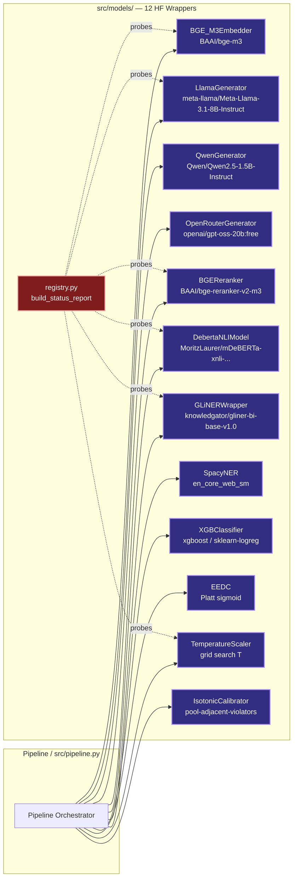
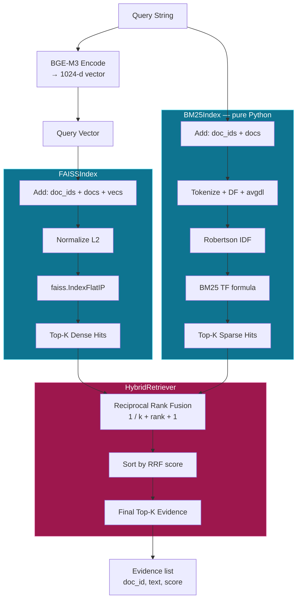
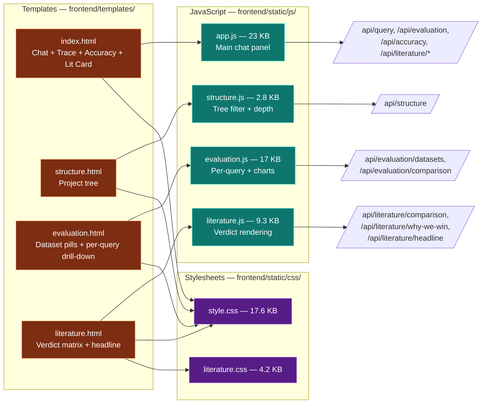
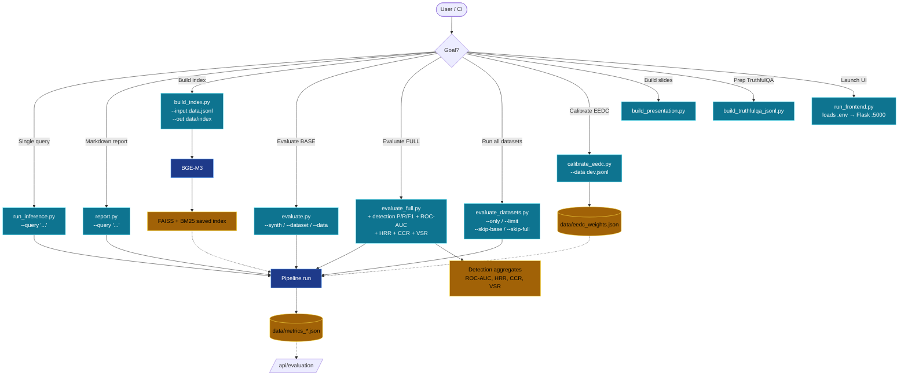
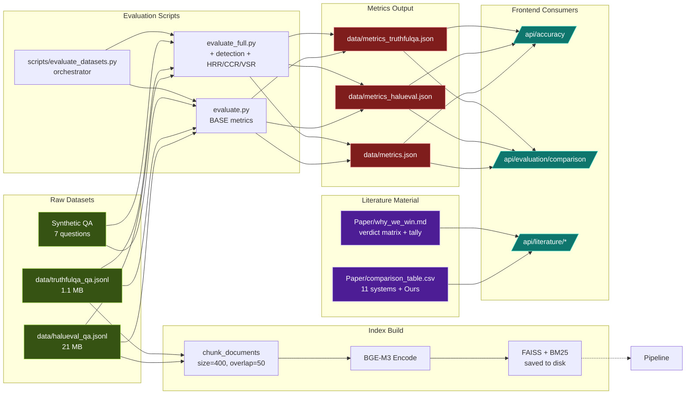
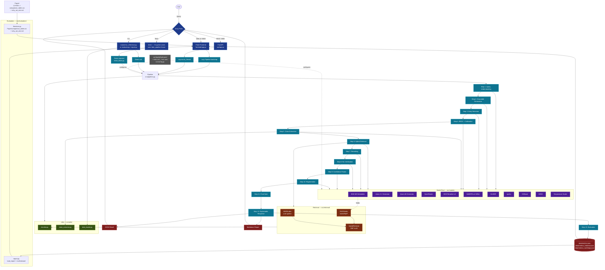
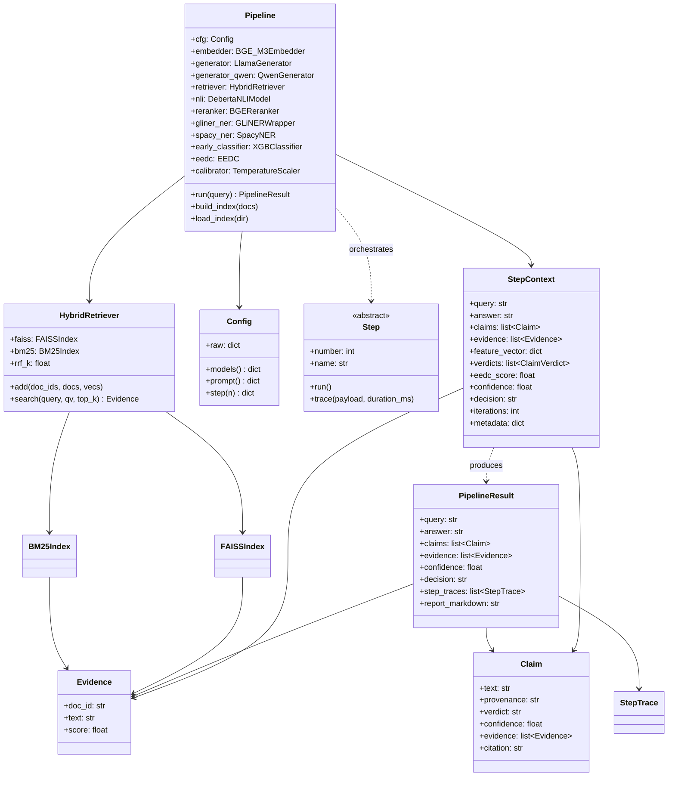

# Hallucination Detection Pipeline — Full Architecture Diagram

This document contains comprehensive Mermaid diagrams covering every layer of the project:
- **Layer 1:** The 13-step core pipeline (data flow)
- **Layer 2:** Models layer (HuggingFace wrappers)
- **Layer 3:** Retrieval layer (FAISS + BM25)
- **Layer 4:** API layer (FastAPI + Flask)
- **Layer 5:** Frontend pages and JS modules
- **Layer 6:** Scripts / CLI entry points
- **Layer 7:** Evaluation & data flow
- **Layer 8:** Full end-to-end system view

All diagrams use the official [Mermaid](https://mermaid.js.org/) syntax and can be rendered by GitHub, VS Code, Obsidian, or any Mermaid-compatible viewer.

---

## Layer 1 — The 13-Step Core Pipeline

This is the heart of the project. Every step is one Python module under `src/steps/`.

```mermaid
flowchart TD
    Start([User Query]) --> S1

    %% ====== STEP 1: QUERY UNDERSTANDING ======
    subgraph S1["Step 1 — Query Understanding"]
        S1A[Intent Classification<br/>heuristic] --> S1B[spaCy NER<br/>en_core_web_sm]
        S1A --> S1C[GLiNER NER<br/>knowledgator/gliner-bi-base-v1.0]
        S1A --> S1D[LLM Query Rewrite<br/>Llama 3.1 / Qwen]
        S1B & S1C & S1D --> S1E[Entities + Variants]
    end
    S1E --> S2

    %% ====== STEP 2: GROUNDED GENERATION ======
    subgraph S2["Step 2 — Grounded Generation"]
        S2A[Backend Selector<br/>llama / qwen] --> S2B[LlamaGenerator<br/>meta-llama/Meta-Llama-3.1-8B-Instruct]
        S2A --> S2C[QwenGenerator<br/>Qwen/Qwen2.5-1.5B-Instruct]
        S2B & S2C --> S2D[Prompt:<br/>Context + Question]
        S2D --> S2E[Initial Answer]
    end
    S2E --> S3

    %% ====== STEP 3: EARLY DETECTION ======
    subgraph S3["Step 3 — Early Hallucination Detection"]
        S3A[BGE-M3 Embedder<br/>BAAI/bge-m3] --> S3B[Cosine Similarity<br/>q × answer]
        S3A --> S3C[Feature Vector:<br/>cosine, claim_count,<br/>overlap, answer_length]
        S3C --> S3D[XGBoost Classifier<br/>or sklearn-logreg]
        S3D --> S3E[Hallucination Probability]
    end
    S3E --> S4

    %% ====== STEP 4: CONFIDENCE ASSESSMENT ======
    subgraph S4["Step 4 — Confidence Assessment (EEDC)"]
        S4A[NLI Entropy H] --> S4B[EEDC Platt Scorer<br/>α·H + β·(1-top1) + γ·(1-cons) + δ]
        S4B --> S4C[Temperature Scaler<br/>grid search T ∈ [0.25, 4.0]]
        S4C --> S4D[Calibrated Score]
    end
    S4D --> S5

    %% ====== STEP 5: ATOMIC CLAIM EXTRACTION ======
    subgraph S5["Step 5 — Atomic Claim Extraction"]
        S5A[Rule-based Splitter<br/>regex sentence] --> S5E[Claims + Provenance]
        S5A --> S5B{Mode?}
        S5B -->|llm| S5C[LLM Splitter<br/>Llama 3.1]
        S5B -->|hybrid| S5D[Rule → LLM fallback]
        S5C & S5D --> S5E
    end
    S5E --> S6

    %% ====== STEP 6: HYBRID RETRIEVAL ======
    subgraph S6["Step 6 — Hybrid Retrieval"]
        S6A[Query Embedding<br/>BGE-M3] --> S6B[FAISS Index<br/>IndexFlatIP]
        S6A --> S6C[BM25 Index<br/>pure-python]
        S6B --> S6D[RRF Fusion<br/>k=60]
        S6C --> S6D
        S6D --> S6E[Top-K Evidence]
    end
    S6E --> S7

    %% ====== STEP 7: RERANKING ======
    subgraph S7["Step 7 — Cross-Encoder Reranking"]
        S7A[BGE-Reranker-v2<br/>BAAI/bge-reranker-v2-m3] --> S7B[Relevance Scores]
        S7B --> S7C[Sort + Top-K]
    end
    S7C --> S8

    %% ====== STEP 8: NLI VERIFICATION ======
    subgraph S8["Step 8 — NLI Verification"]
        S8A[DeBERTa-v3-MNLI<br/>mDeBERTa-xnli-multilingual] --> S8B[For each claim × evidence]
        S8B --> S8C{Label?}
        S8C -->|entail| S8D[supported]
        S8C -->|contradict| S8E[contradicted]
        S8C -->|neutral| S8F[unknown]
        S8D & S8E & S8F --> S8G[Per-claim Verdicts]
    end
    S8G --> S9

    %% ====== STEP 9: CONFIDENCE FUSION ======
    subgraph S9["Step 9 — Confidence Fusion"]
        S9A[Weights:<br/>sim 0.30 / ret 0.20<br/>nli 0.25 / cov 0.15<br/>eedc 0.10] --> S9B[Weighted Sum]
        S9B --> S9C[Per-claim Score]
        S9B --> S9D[Overall Confidence]
    end
    S9D --> S10

    %% ====== STEP 10: REGENERATION ======
    subgraph S10["Step 10 — Evidence-Guided Regeneration"]
        S10A{Verdicts} -->|bad claims| S10B{Mode?}
        S10B -->|stub| S10C[KEEP]
        S10B -->|evidence| S10D[Join supported claims]
        S10B -->|regenerate| S10E[Llama 3.1 rewrite<br/>+ verified evidence]
        S10D & S10E --> S10F[Final Answer Candidate]
    end
    S10F --> S11

    %% ====== STEP 11: FINAL GATE ======
    subgraph S11["Step 11 — Final Verification Gate"]
        S11A[Confidence score] --> S11B{conf ≥ 0.70<br/>AND<br/>unsupp == 0?}
        S11B -->|yes| S11C[✅ PASS]
        S11B -->|no, conf < 0.30| S11D[❌ ABSTAIN]
        S11B -->|gray zone| S11E{attempts &lt; max?}
        S11E -->|yes| S11F[🔄 REGEN]
        S11E -->|no| S11G[best-of PASS/ABSTAIN]
    end
    S11C & S11D & S11F & S11G --> S12

    %% ====== STEP 12: EXPLAINABLE RESPONSE ======
    subgraph S12["Step 12 — Explainable Response"]
        S12A[JSON Payload<br/>query, answer, claims,<br/>evidence, confidence, decision] --> S12C[Output]
        S12B[Markdown Report<br/>per-claim verdicts +<br/>evidence + decision log] --> S12C
    end
    S12C --> S13

    %% ====== STEP 13: EVALUATION ======
    subgraph S13["Step 13 — Evaluation"]
        S13A[Generation Metrics:<br/>BLEU, ROUGE-L, BERTScore] --> S13F[Aggregate Report]
        S13B[Retrieval Metrics:<br/>R@K, P@K, MRR, nDCG] --> S13F
        S13C[Detection Metrics:<br/>Acc, P/R/F1, ROC-AUC] --> S13F
        S13D[Claim Metrics:<br/>Precision, Recall, F1] --> S13F
        S13E[Pipeline Metrics:<br/>HRR, CCR, VSR] --> S13F
    end
    S13F --> End([PipelineResult +<br/>data/metrics.json])

    %% ====== STYLING ======
    classDef step fill:#1e3a8a,stroke:#60a5fa,stroke-width:2px,color:#fff
    classDef sub fill:#0f766e,stroke:#5eead4,stroke-width:1.5px,color:#fff
    classDef decision fill:#7c2d12,stroke:#fb923c,stroke-width:2px,color:#fff
    classDef terminal fill:#166534,stroke:#86efac,stroke-width:2px,color:#fff
    classDef model fill:#4c1d95,stroke:#c4b5fd,stroke-width:1.5px,color:#fff
    class S1,S2,S3,S4,S5,S6,S7,S8,S9,S10,S11,S12,S13 step
    class S1A,S1B,S1C,S1D,S1E,S2A,S2B,S2C,S2D,S2E,S3A,S3B,S3C,S3D,S3E,S4A,S4B,S4C,S4D,S5A,S5B,S5C,S5D,S5E,S6A,S6B,S6C,S6D,S6E,S7A,S7B,S7C,S8A,S8B,S8C,S8D,S8E,S8F,S8G,S9A,S9B,S9C,S9D,S10A,S10B,S10C,S10D,S10E,S10F,S12A,S12B,S12C,S13A,S13B,S13C,S13D,S13E,S13F sub
    class S11B,S11E decision
    class Start,End terminal
    class S2B,S2C,S3A,S5C,S6B,S7A,S8A model
```

---

## Layer 2 — Models Layer (HuggingFace Wrappers)



---

## Layer 3 — Retrieval Layer (FAISS + BM25 Hybrid)



---

## Layer 4 — API Layer (FastAPI + Flask)

```mermaid
flowchart TB
    subgraph CLIENTS[Clients]
        C1[curl / PowerShell]
        C2[Web Browser]
        C3[Python / JS SDK]
    end

    subgraph FAST[FastAPI Service — api/app.py — :8000]
        F1[GET /health]
        F2[POST /index]
        F3[POST /query]
        F4[GET /metrics]
        F5[GET /structure]
        F6[GET /models/status]
        F_LIFESPAN[asyncio.to_thread<br/>Pipeline singleton]
    end

    subgraph FLASK[Flask Frontend — frontend/app.py — :5000]
        L1[GET /]
        L2[GET /structure]
        L3[GET /evaluation]
        L4[GET /literature]
        L5[GET /api/health]
        L6[POST /api/index]
        L7[POST /api/query]
        L8[GET /api/metrics]
        L9[GET /api/evaluation]
        L10[GET /api/evaluation/datasets]
        L11[GET /api/evaluation/comparison]
        L12[GET /api/accuracy]
        L13[GET /models/status]
        L14[GET /api/literature/comparison]
        L15[GET /api/literature/why-we-win]
        L16[GET /api/literature/headline]
        L17[GET /api/structure]
        L_LAZY[get_pipeline<br/>Lazy bootstrap]
    end

    C1 --> F1 & F2 & F3 & F4 & F5 & F6
    C2 --> L1 & L2 & L3 & L4
    C3 --> L5 & L6 & L7 & L8 & L9 & L10 & L11 & L12 & L13 & L14 & L15 & L16 & L17

    F1 & F2 & F3 & F4 & F5 & F6 --> F_LIFESPAN
    L5 & L6 & L7 & L8 & L9 & L10 & L11 & L12 & L13 & L14 & L15 & L16 & L17 --> L_LAZY

    F_LIFESPAN --> PIPE[src/pipeline.Pipeline]
    L_LAZY --> PIPE

    classDef fast fill:#1e40af,stroke:#93c5fd,color:#fff
    classDef flask fill:#15803d,stroke:#86efac,color:#fff
    classDef client fill:#525252,stroke:#d4d4d4,color:#fff
    class F1,F2,F3,F4,F5,F6,F_LIFESPAN fast
    class L1,L2,L3,L4,L5,L6,L7,L8,L9,L10,L11,L12,L13,L14,L15,L16,L17,L_LAZY flask
    class C1,C2,C3 client
```



---

## Layer 5 — Frontend Pages & JavaScript Modules



---

## Layer 6 — Scripts / CLI Entry Points



---

## Layer 7 — Evaluation & Data Flow



---

## Layer 8 — Full End-to-End System View

This single diagram shows the entire stack from user input to evaluation storage.



---

## Layer 9 — Class / Module Dependency Graph (Code-Level)

For developers who want to trace `import` chains.



---

## How to Render These Diagrams

| Tool | How to use |
|---|---|
| **GitHub** | Just open `architecture.md` in the repo — GitHub renders Mermaid blocks automatically |
| **VS Code** | Install the "Markdown Preview Mermaid Support" extension |
| **Obsidian** | Native Mermaid support — drop the file in your vault |
| **Mermaid Live Editor** | Paste any code block at <https://mermaid.live/> |
| **CLI** | `npx -p @mermaid-js/mermaid-cli mmdc -i architecture.md -o architecture.svg` |

---

## Diagram Index

1. **Layer 1** — The 13-step core pipeline (the heart of the project)
2. **Layer 2** — Models layer (12 HF wrappers + registry)
3. **Layer 3** — Retrieval layer (FAISS + BM25 + RRF)
4. **Layer 4** — API layer (FastAPI + Flask routes)
5. **Layer 5** — Frontend pages & JS modules
6. **Layer 6** — Scripts / CLI entry points
7. **Layer 7** — Evaluation & data flow
8. **Layer 8** — Full end-to-end system view
9. **Layer 9** — Class / module dependency graph

Every module, class, route, and script from the project is represented. Color coding:

- **Blue** — entry points & step pipeline
- **Cyan / teal** — pipeline internals
- **Purple** — models (HuggingFace)
- **Orange** — retrieval & decision points
- **Red** — I/O & metrics storage
- **Green** — utilities
- **Gray** — configuration
